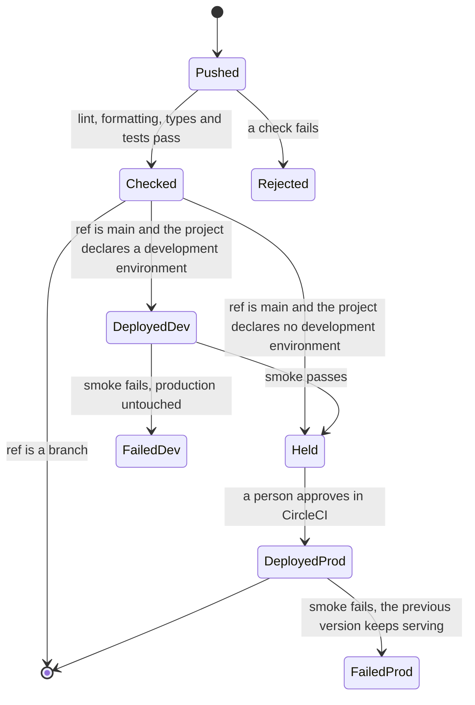

# infrastructure

The deployment platform of NextNode projects. One CircleCI configuration, kept here on `main`, runs the checks and the Cloudflare deployment of every project repository. A project holds no CI file. It declares what it needs in a `nextnode.toml`, exposes a few package scripts, and this repository does the rest.

## How a change reaches production

1. A push on a project repository starts a CircleCI pipeline that reads its configuration from this repository and checks out the project.
2. The project's own scripts run the checks. A branch stops here, and touches no secret.
3. On `main`, the deployment job trades its OpenID Connect (OIDC) token for the secrets of the environment, builds the project and runs its migrations as a separate user, uploads the Worker with Wrangler, then converges the environment's Cloudflare resources with the platform package, a Pulumi program of this repository, which attaches the environment's domain to the Worker.
4. A request on the health route decides. Development serves at once. Production is uploaded as a version without traffic, checked on its preview URL, and promoted only when the check passes. The first deployment of a production Worker is the exception: nothing served before, so it serves at once and the check follows.
5. Development is deployed first when the project declares one, then a person approves in CircleCI, then production.

[docs/architecture.md](docs/architecture.md) explains each part, the secrets model, what a failure leaves behind, and every decision with its reason. [docs/configuration.md](docs/configuration.md) is the contract a project fulfils: the keys of `nextnode.toml`, what its Wrangler configuration may and may not contain, and the scripts the pipeline calls.

## Onboarding a project

A project needs three things, described in [docs/configuration.md](docs/configuration.md): a `nextnode.toml` at its root, a pinned `packageManager` in its `package.json`, and the scripts `lint`, `format:check`, `type-check` and `build`. Its secrets go in the Infisical project named after the repository, one environment per deployment environment.

A maintainer then registers the repository: a CircleCI project whose pipeline definition reads this repository's configuration and checks out the new one, and the Infisical project with the pipeline's machine identity as a viewer. [docs/architecture.md](docs/architecture.md#registering-a-repository) describes the registration by role and names the shared identifiers it needs.

## Changing this repository

A merge on `main` is a release to every project at once. [AGENTS.md](AGENTS.md) holds the guarantees that every change must keep, the rules of the pipeline file and of the platform package, and the checks: a pipeline change is validated by running the canary repository's pipeline from the branch before it merges.
