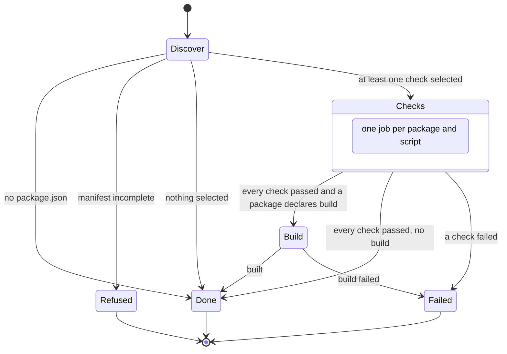
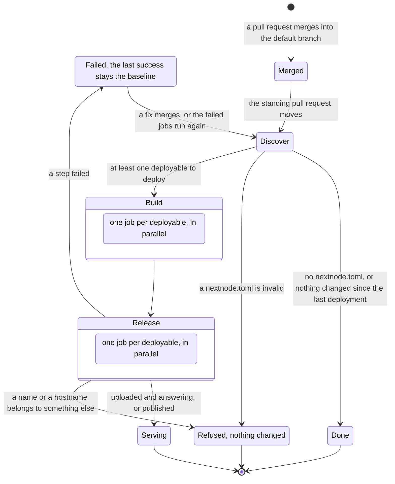

# NextNode infrastructure

The checks and the deployments of every NextNode project, kept in one place. A project repository holds no workflow file: organization rulesets require the workflows of this repository on its pull requests, and GitHub runs them inside the project, against the project's own code. `Checks` verifies a pull request. `Deploy plan` says what its merge would deploy. `Deploy` deploys the default branch after the merge.

The repository is two things. Workflow files that say when a run starts, which jobs exist and what each may touch. And a TypeScript program that makes every decision: what the project declares, which packages a change reaches, which command a check runs, what a merge deploys and where. Each job fetches the program at the workflow's own commit and runs it with Node, with no build. The workflows carry no list of projects, packages, checks or deployments: the program reads the repository it runs in, so the same files serve a single package, a pnpm workspace with many packages, and a repository that holds no JavaScript at all.

## What the checks do



1. **Discover** checks out the project with full history, reads the root `package.json`, decides which packages are concerned, and emits one matrix entry per package and declared script. Its job summary says what was selected and why, and names the revision of the program that decided.
2. **Check** runs each matrix entry as its own job, in parallel, each reported as its own status on the pull request. One failure never stops the others.
3. **Build** runs once every check passed, for the selected packages that declare a `build` script, in dependency order.
4. The run's conclusion is what the ruleset reads: a failed check or build blocks the merge, a repository with nothing to check merges freely.

A new push to the pull request cancels the run in progress. A run another workflow started, such as a release, keeps that workflow's event and is not cancelled. How each job works, which packages a change selects and what a failure leaves are in [docs/architecture.md](docs/architecture.md).

## What a deployment does



1. A merge moves the head of the **standing pull request**, the one pull request each repository keeps open from its default branch into a branch that never moves. A ruleset requires `Deploy` there, so the merge starts the run.
2. **Discover** reads each `nextnode.toml` and compares the commit with the last deployment of each deployable that succeeded. It selects what the changes since then reach, and its summary gives the reason for each.
3. **Build** installs, builds and bundles each selected deployable on its own runner, and leaves plain files.
4. **Release** takes those files and deploys them: it creates the databases and buckets the file binds, applies the migrations, uploads the Worker and waits for it to answer, or publishes the package. It is the only job that holds credentials and it runs nothing of the project.
5. GitHub's environment of each deployable records what serves, with its address. A failure says its cause and the next action, and the next run deploys everything since the last success.

On a pull request, `Deploy plan` shows the same selection before the merge. Why deployments run on a pull request, what each job holds and what each failure leaves are in [docs/deployment.md](docs/deployment.md).

## What a project declares

Everything the checks need comes from the project's root `package.json`. A missing field refuses the run with an annotation that names the field, before any job installs anything.

| Field            | Read as                                                                                                                                                                         |
| ---------------- | ------------------------------------------------------------------------------------------------------------------------------------------------------------------------------- |
| `packageManager` | The exact pnpm version, as `pnpm@X.Y.Z`. The install is frozen to the lockfile.                                                                                                 |
| `engines.node`   | The Node major, the first number of the range, which the check jobs install. A major too old for Node to strip types is refused, and the refusal names the lowest one accepted. |
| `scripts`        | The checks. A script that exists runs, a script that does not exist is not a check.                                                                                             |

The scripts the workflow knows, and the status each one produces on the pull request:

| Script             | Status                          |
| ------------------ | ------------------------------- |
| `lint`             | Lint                            |
| `format:check`     | Format                          |
| `type-check`       | TypeScript                      |
| `test:unit`        | Unit tests                      |
| `test:integration` | Integration tests               |
| `test:e2e`         | End-to-end tests                |
| `build`            | Build, after every check passed |

In a workspace the status carries the package name, as `Lint (@scope/name)`, and the workspace root's own scripts are not checks: each package declares what checks it.

To be deployed, a project adds one file and nothing else: a `nextnode.toml` at its root, or beside the `package.json` of each package of a workspace that deploys.

```toml
main = "src/worker.ts"
compatibility_date = "2026-11-01"

[[d1_databases]]
binding = "DB"

[environments.production]
domain = "api.example.com"
```

The keys are Wrangler's own, so the file is also the Worker's local configuration. It names no Worker, no account and no database: the platform derives every name from the repository and the package. A file with a `[package]` table publishes the package beside it to npm instead. Every key is in [docs/nextnode-toml.md](docs/nextnode-toml.md).

## Loading it into a repository

Each organization ruleset names the repositories it applies to, and adding a repository is adding its name to an include list. The ruleset "Checks required on pull requests" asks for a `package.json` that declares the fields above. The two deploy rulesets, and the little a repository needs before its first deployment, are in [docs/deployment.md](docs/deployment.md#setting-up-a-repository).

## Changing it

The rules for a change, the local run against the canaries and the canary pull requests are in [AGENTS.md](AGENTS.md).
