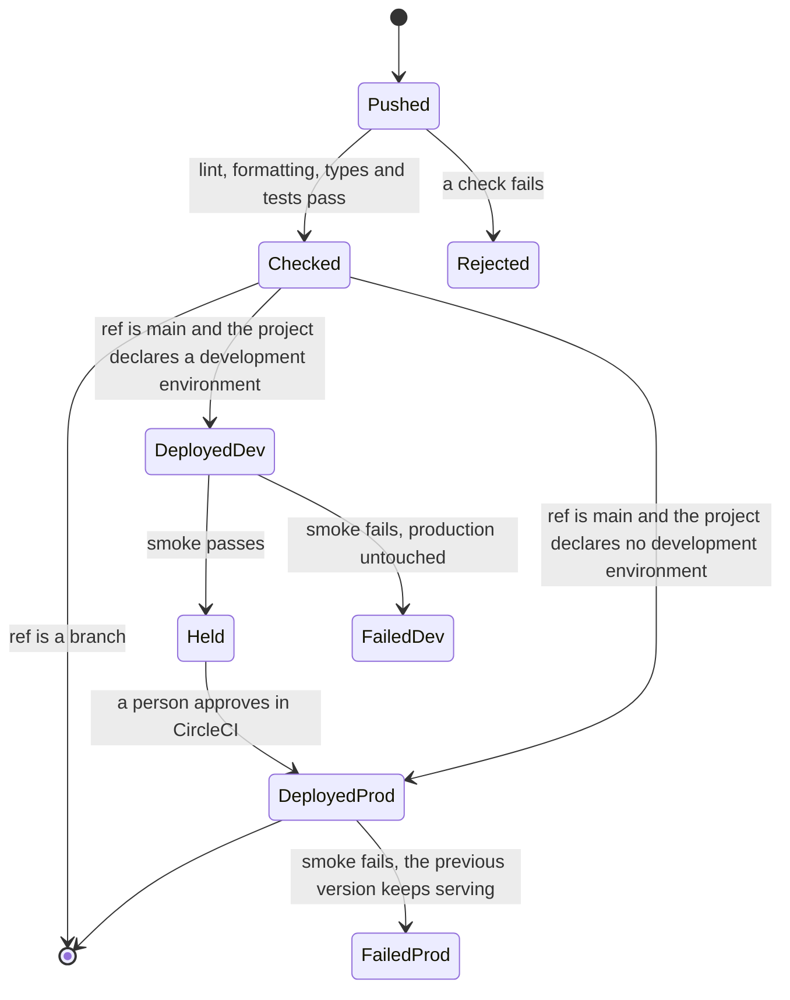

# infrastructure

The deployment platform of NextNode projects. One CircleCI configuration, kept here on `main`, runs the checks and the Cloudflare deployments of every project repository. A project declares what it needs in its `nextnode.toml` and holds no CI file of its own.

## How a change reaches production

1. A push on a project repository starts a CircleCI pipeline that reads its configuration from this repository.
2. The project's own scripts run the checks. A branch stops here.
3. On `main`, the deployment job logs in to the vault with the job's OIDC token, creates or updates the Cloudflare resources with Pulumi, builds the project, runs its migrations, uploads the Worker with Wrangler and checks the health route.
4. Development is deployed first when the project has one, then a person approves, then production.

[docs/architecture.md](docs/architecture.md) explains each part, the secrets model, what a failure leaves behind, and the decisions with their reasons. [AGENTS.md](AGENTS.md) holds the rules for changing this repository.

## Registering a project

A maintainer runs the registration described in [docs/architecture.md](docs/architecture.md#registering-a-repository). The project then needs a `nextnode.toml`, a pinned `packageManager`, and the scripts `lint`, `format:check`, `type-check` and `build`.

## Validating a change

Pipeline changes are validated by running the canary repository's pipeline from the branch before merging. See the checks section of [AGENTS.md](AGENTS.md#checks).
