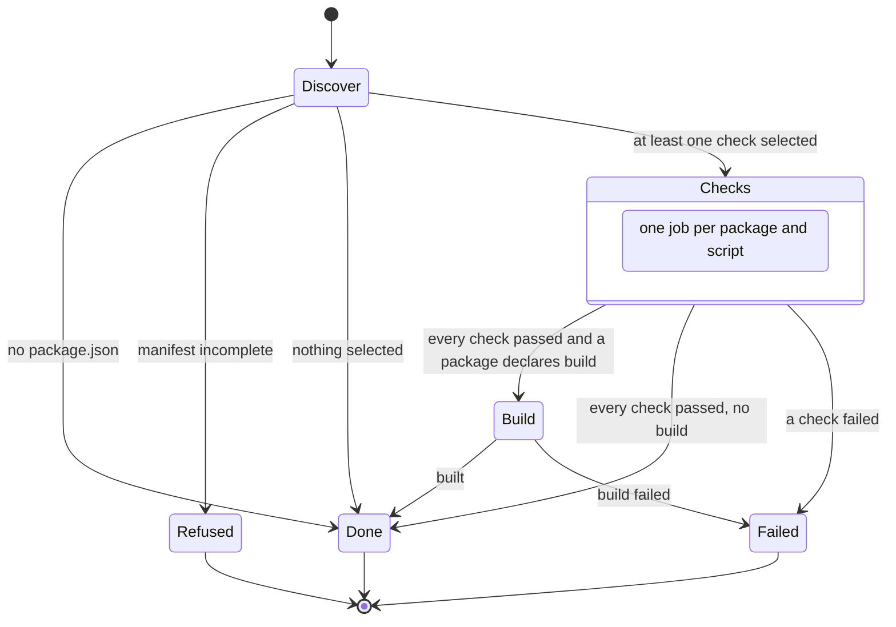

# NextNode infrastructure

The CI of every NextNode project, kept in one place. A project repository holds no workflow file: an organization ruleset requires the `Checks` workflow of this repository on every pull request, and GitHub runs it inside the project, against the project's own code.

The repository is two things. A workflow file that says when the checks run, which jobs exist and what they may touch. And a TypeScript program that makes every decision: what the project declares, which packages a change reaches, which command each check runs. Each job fetches the program at the workflow's own commit and runs it with Node, with no install and no build. The workflow carries no list of projects, packages or checks: the program reads the repository it runs in, so one file serves a single package, a pnpm workspace with many packages, and a repository that holds no JavaScript at all.

## What a run does

1. **Discover** checks out the project with full history, reads the root `package.json`, decides which packages are concerned, and emits one matrix entry per package and declared script. Its job summary says what was selected and why, and names the revision of the program that decided.
2. **Check** runs each matrix entry as its own job, in parallel, each reported as its own status on the pull request. One failure never stops the others.
3. **Build** runs once every check passed, for the selected packages that declare a `build` script, in dependency order.
4. The run's conclusion is what the ruleset reads: a failed check or build blocks the merge, a repository with nothing to check merges freely.

A new push to the pull request cancels the run in progress. A run another workflow started, such as a release, keeps that workflow's event and is not cancelled. How each job works, which packages a change selects and what a failure leaves are in [docs/architecture.md](docs/architecture.md).

## What a project declares

Everything the workflow needs comes from the project's root `package.json`. A missing field refuses the run with an annotation that names the field, before any job installs anything.

| Field            | Read as                                                                                                                                                                         |
| ---------------- | ------------------------------------------------------------------------------------------------------------------------------------------------------------------------------- |
| `packageManager` | The exact pnpm version, as `pnpm@X.Y.Z`. The install is frozen to the lockfile.                                                                                                 |
| `engines.node`   | The Node major, the first number of the range, which the check jobs install. A major too old for Node to strip types is refused, and the refusal names the lowest one accepted. |
| `scripts`        | The checks. A script that exists runs, a script that does not exist is not a check.                                                                                             |

The scripts the workflow knows, and the status each one produces on the pull request:

| Script             | Status                          |
| ------------------ | ------------------------------- |
| `lint`             | Lint                            |
| `format:check`     | Format                          |
| `type-check`       | TypeScript                      |
| `test:unit`        | Unit tests                      |
| `test:integration` | Integration tests               |
| `test:e2e`         | End-to-end tests                |
| `build`            | Build, after every check passed |

In a workspace the status carries the package name, as `Lint (@scope/name)`, and the workspace root's own scripts are not checks: each package declares what checks it.

## Loading it into a repository

The organization ruleset "Checks required on pull requests" names the repositories it applies to. Adding a repository is adding its name to the ruleset's include list, once its `package.json` declares the fields above.

## Changing it

The rules for a change, the local run against the canaries and the canary pull requests are in [AGENTS.md](AGENTS.md).
