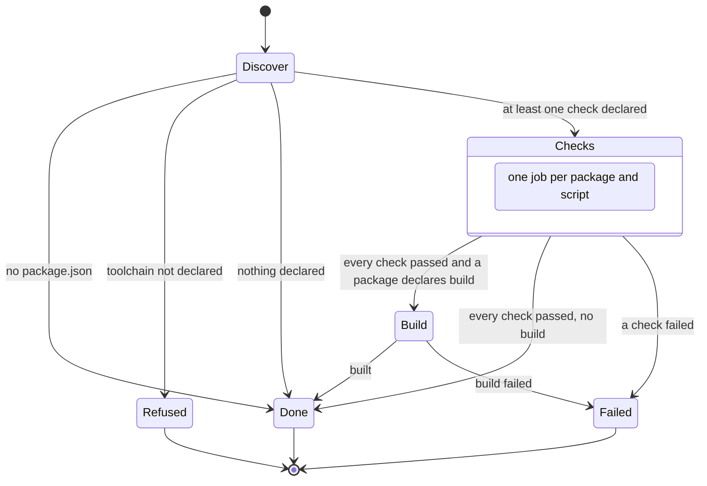
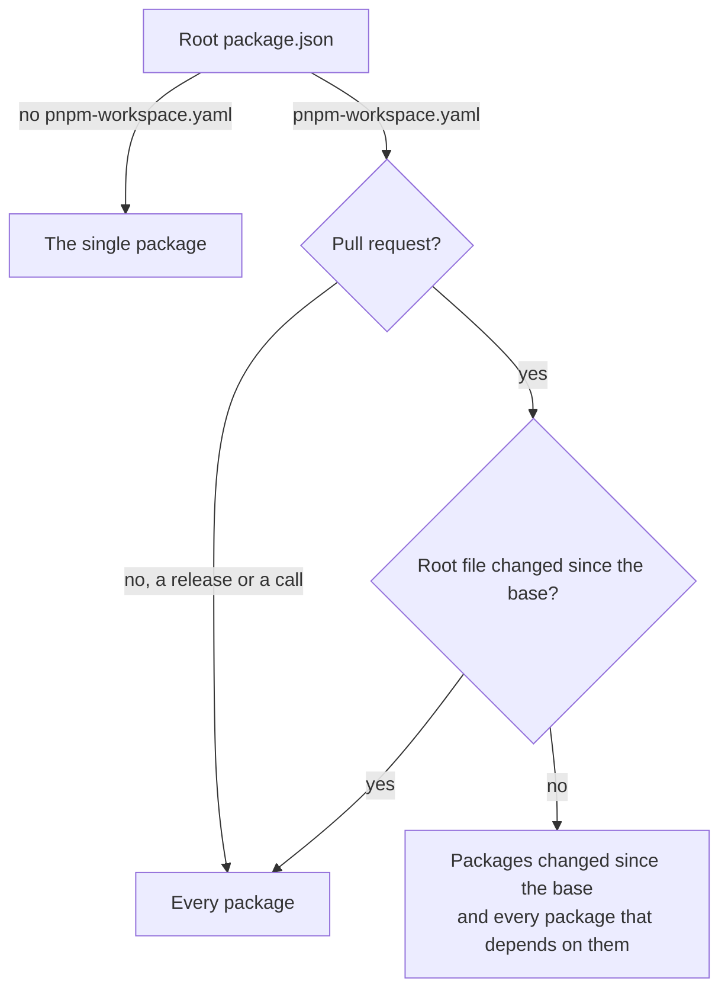

# NextNode infrastructure

The CI of every NextNode project, kept in one place. A project repository holds no workflow file: an organization ruleset requires the `Checks` workflow of this repository on every pull request, and GitHub runs it inside the project, against the project's own code.

The workflow carries no list of projects, packages or checks. It reads the repository it runs in and runs what that repository declares, so one file serves a single package, a pnpm workspace with many packages, and a repository that holds no JavaScript at all.

## What a run does

1. **Discover** checks out the project with full history, reads the root `package.json`, decides which packages are concerned, and emits one matrix entry per package and declared script. Its job summary says what was selected and why.
2. **Check** runs each matrix entry as its own job, in parallel, each reported as its own status on the pull request. One failure never stops the others.
3. **Build** runs once every check passed, for the selected packages that declare a `build` script, in dependency order.
4. The run's conclusion is what the ruleset reads: a failed check or build blocks the merge, a repository with nothing to check merges freely.

A new push to the pull request cancels the run in progress. A run started from a release workflow is never cancelled.

## What a project declares

Everything the workflow needs comes from the project's root `package.json`. A missing field refuses the run with an annotation that names the field, before any job installs anything.

| Field | Read as |
| --- | --- |
| `packageManager` | The exact pnpm version, as `pnpm@X.Y.Z`. The install is frozen to the lockfile. |
| `engines.node` | The Node major. The first number of the range is the version the jobs run. |
| `scripts` | The checks. A script that exists runs; a script that does not exist is not a check. |

The scripts the workflow knows, and the status each one produces on the pull request:

| Script | Status |
| --- | --- |
| `lint` | Lint |
| `type-check` | TypeScript |
| `test:unit` | Unit tests |
| `test:integration` | Integration tests |
| `test:e2e` | End-to-end tests |
| `build` | Build, after every check passed |

In a workspace the status carries the package name, as `Lint (@scope/name)`, and the workspace root's own scripts are not checks: each package declares what checks it.

## Which packages run

Selection follows the package graph, never file paths. A change in a shared package runs the checks of every package that depends on it, transitively, because that is where the change can break something. The base is the merge base with the target branch, so an old branch is not punished for what happened on `main` meanwhile.

Root files invalidate everything: the root `package.json`, the lockfile, the workspace file, the root `tsconfig.json`, `turbo.json` and `.npmrc`. A change to any of them selects every package, because every package reads them.

Two kinds of change are filtered out of the diff: Markdown files never select a package, and a change that only touches test files selects the package but not its dependents.

## How a check runs

The job installs the project's dependencies, then runs the script through the executor the repository calls for:

| Repository | Executor | What runs before the script |
| --- | --- | --- |
| Single package | pnpm | Nothing |
| Workspace | pnpm | `build` of the package's workspace dependencies, when they declare one |
| Workspace with `turbo.json` | Turborepo | What `dependsOn` says, with Turborepo's cache |

The package and script names reach the shell as environment variables, never as text of the command.

## What a failure leaves

| Outcome | On the pull request |
| --- | --- |
| A field missing from `package.json` | The Discover job fails with an annotation on `package.json`; no other job starts. |
| A check failed | Its status is red, the other checks finish, Build is skipped. |
| The build failed | The Build status is red. |
| A newer push | The older run is cancelled and reads as such. |
| Nothing to check | Discover is green, no other job runs, the summary says why. |

## Loading it into a repository

The organization ruleset "Checks required on pull requests" names the repositories it applies to. Adding a repository is adding its name to the ruleset's include list, once its `package.json` declares the fields above.

## Testing a change

A change to the workflow is tested on the canary repository before it reaches `main`: the ruleset entry can point at a branch of this repository, and a pull request on the canary shows the result. The rules for a change are in [AGENTS.md](AGENTS.md).
