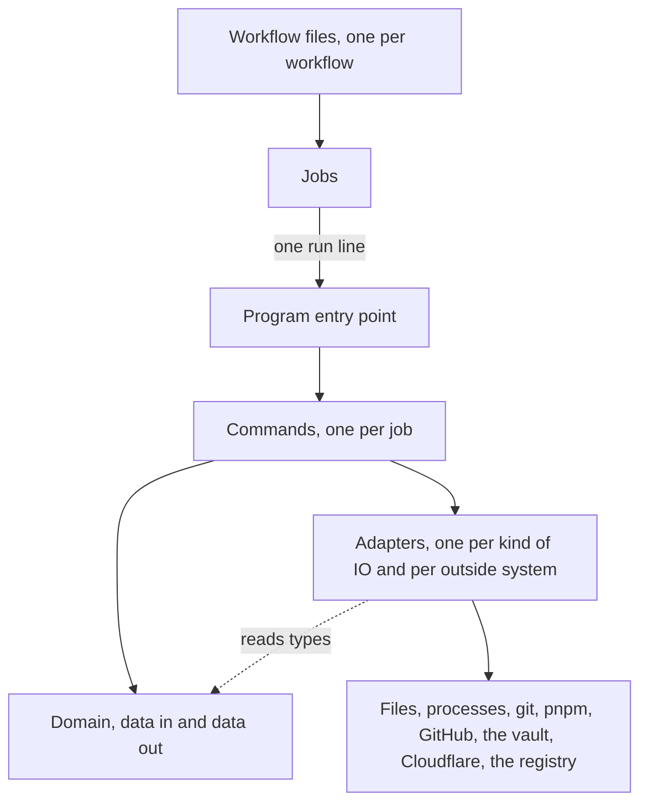
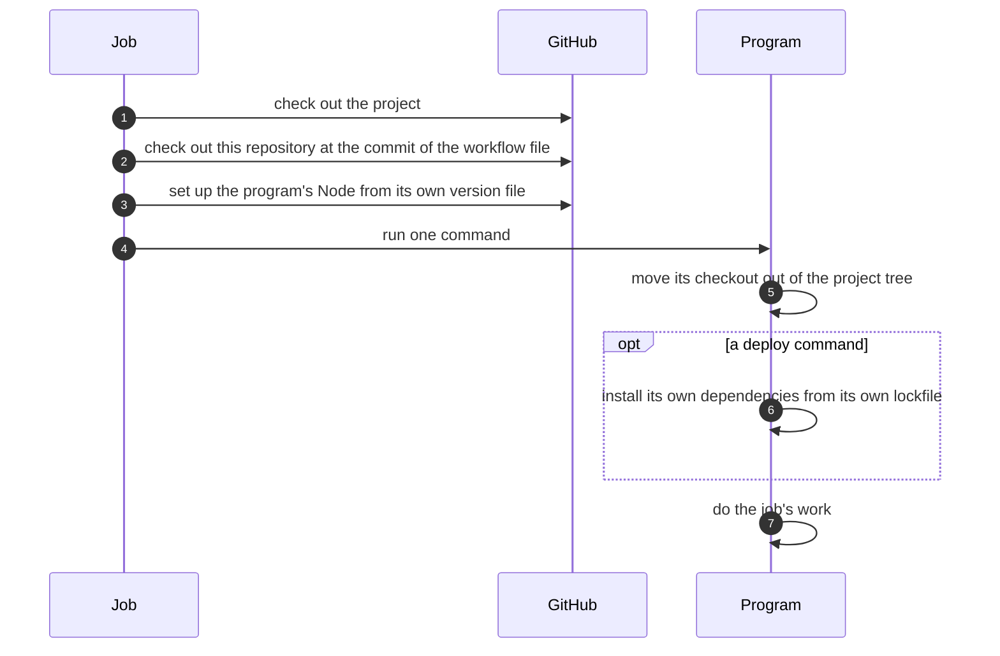
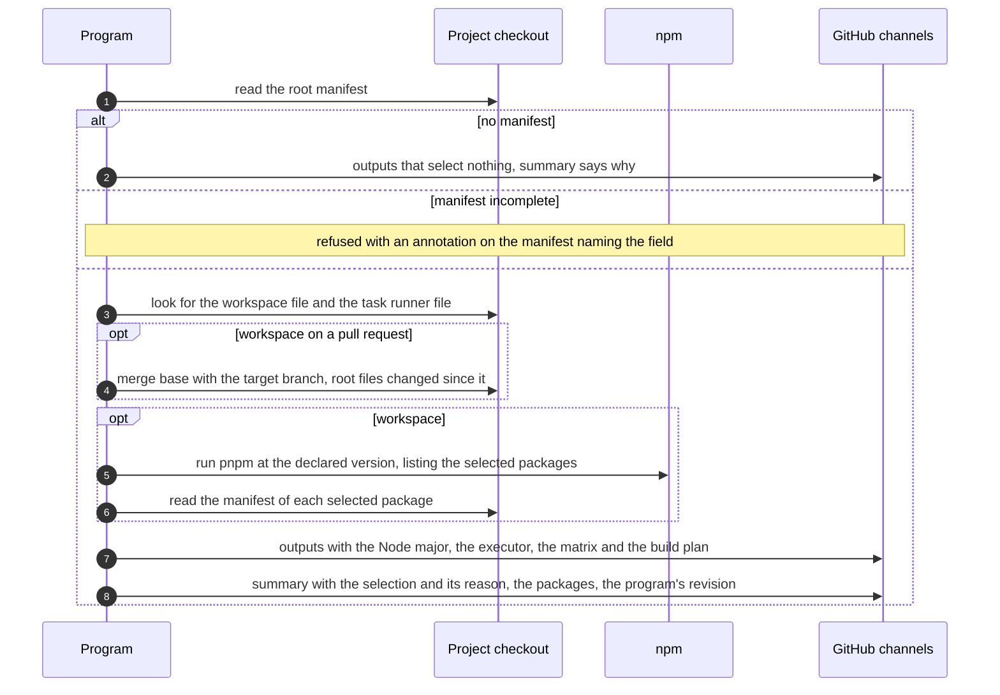
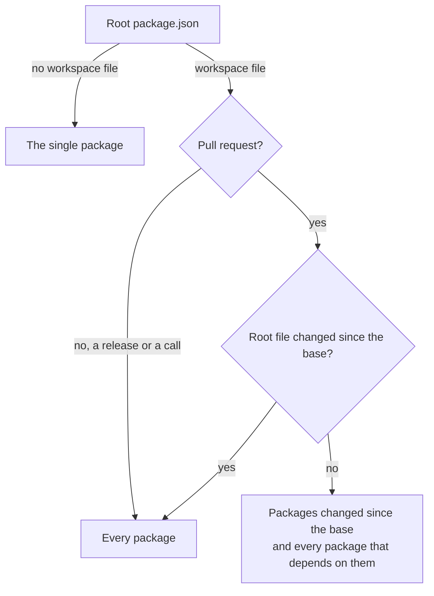
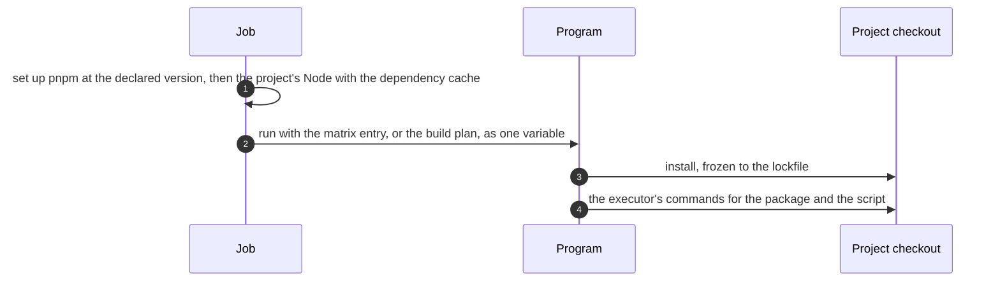

# Architecture

How the repository is split between the workflow files and the program, and what happens in each job of a `Checks` run. The deploy workflows share the split and have a page of their own, [deployment.md](deployment.md). The rules that keep it this way are in the root [AGENTS.md](../AGENTS.md).

## The parts

A workflow file holds what only GitHub reads. Everything else is the program.

| The workflow file decides                                          | The program decides                                         |
| ------------------------------------------------------------------ | ----------------------------------------------------------- |
| When a run starts, and that a newer push cancels it                | Whether the repository has anything to check                |
| What a job may touch, and which token GitHub hands it              | Whether the manifest is complete, and how to refuse it      |
| Which jobs exist, which waits for which, which is skipped          | Which packages a change reaches, and through which executor |
| Which action versions, runner image and Node run the program       | Which statuses exist, and which command each one runs       |
| That a matrix entry or an output reaches the program as a variable | What goes in the outputs and the job summary                |

The program is in three layers. The domain holds types and rules and performs no IO: it decodes a manifest into a typed value, picks the executor, turns a selection into pnpm's filter, turns a plan into commands as argument arrays, and renders the outputs and the summary. The adapters each hold one kind of IO or one outside system and may read the domain's types. The commands, one per job, wire adapters and domain. The entry point dispatches on the command name and turns a refusal into an annotation.

The deploy commands reuse what the checks decide with: the manifest decoder, the executor, the build commands and pnpm's filter. They add the decoder of `nextnode.toml`, the rule that selects what a merge deploys, the configuration a release uploads with, and one adapter per outside system.

## How a job gets the program

GitHub tells a job which repository and commit its workflow file came from, and the job checks that out beside the project. A branch under test therefore runs the branch's program, and `main` runs the program of `main`, with nothing to publish and no reference to bump. The checkout can only land inside the workspace, so the program moves it to the runner's scratch directory before anything of the project runs. The project's lint, format and test tools walk the tree they run in, and must never see a platform file.

Node loads the program's TypeScript as is, with no build output. The check commands have no dependency and install nothing. The deploy commands have a few: a TOML parser for every job that reads a `nextnode.toml`, and tools for signing storage requests, bundling, uploading and provisioning. The program installs them itself once it has left the project tree, from its own lockfile, with the pnpm its own manifest pins and with lifecycle scripts off, so no file of the project takes part. A module loads a dependency when it calls it, never when it is imported, which keeps the check commands runnable with nothing installed.

The jobs that only read the project, and the jobs that never see it, run the program on the Node version this repository pins in `.node-version`. The jobs that install and build the project run it on the project's Node, the major its manifest declares, which is why that major must be one from which Node strips types.

## Checks

### Discover

The outputs are the contract between the jobs: the Node major the other jobs install, the executor, the matrix as a JSON list, and the build plan as a JSON object or nothing. Each is one line, so a project value with a line break is refused rather than written.

#### Which packages run

Selection follows the package graph, never file paths. A change in a shared package runs the checks of every package that depends on it, transitively, because that is where the change can break something. The base is the merge base with the target branch, so an old branch is not punished for what happened on `main` meanwhile. pnpm's own filter computes the set, so the workflow never guesses the graph.

Root files invalidate everything. The root manifest, the lockfile, the workspace file, the root TypeScript configuration, the task runner file and `.npmrc` are read by every package, so a change to any of them selects every package. The list lives in the domain next to the selection rule.

Two kinds of change are filtered out of the diff: Markdown files never select a package, and a change that only touches test files selects the package but not its dependents. When nothing is selected, the matrix is empty, no check job starts and the run is green.

### Check and Build

| Repository                  | Executor  | What runs before the script                                            |
| --------------------------- | --------- | ---------------------------------------------------------------------- |
| Single package              | pnpm      | Nothing                                                                |
| Workspace                   | pnpm      | `build` of the package's workspace dependencies, when they declare one |
| Workspace with `turbo.json` | Turborepo | What `dependsOn` says, with Turborepo's cache                          |

The build job runs the same way for the selected packages that declare a build, in dependency order. Every command is an argument array handed to a child process: no shell ever reads a package name or a script name.

### What a failure leaves

| Outcome                                                       | On the pull request                                                                                  |
| ------------------------------------------------------------- | ---------------------------------------------------------------------------------------------------- |
| The manifest cannot be read, or a field is missing or too old | The Discover job fails with an annotation on `package.json`. No other job starts.                    |
| A check failed                                                | Its status is red, the other checks finish, Build is skipped.                                        |
| The build failed                                              | The Build status is red.                                                                             |
| A newer push                                                  | The older run is cancelled and reads as such.                                                        |
| Nothing to check, or nothing selected                         | Discover is green, no other job runs, the summary says why.                                          |
| The program itself fails                                      | The job fails with an annotation carrying the error, and the step log shows the command that failed. |

## Deployments

`Deploy plan` and `Deploy` are built from the same parts: a workflow file with one `run` line per job, a command per job, adapters and the domain. What differs is what the jobs hold. `Checks` holds nothing, so one kind of job can do everything. A deployment holds credentials, so its jobs are split between those that run the project and those that hold something. The trigger, the jobs, the selection, the release and what each failure leaves are in [deployment.md](deployment.md).

## Trust boundary

This is the boundary of `Checks`. The deploy workflows keep it for every job that runs the project and add a second one around the job that holds credentials, described in [deployment.md](deployment.md#trust-boundary).

| Trusted                                                             | Untrusted                                                                                                                         |
| ------------------------------------------------------------------- | --------------------------------------------------------------------------------------------------------------------------------- |
| The job, with the read-only repository token GitHub gives every run | The project's code, its dependencies and their lifecycle scripts, its `.npmrc`, its workspace file, its package names and scripts |

The token is never written into either checkout and never referenced by a step. What the project controls travels one of three ways: as JSON that a decoder turns into a typed value, as an element of an argument array that a child process receives, or as a variable the workflow sets from a matrix entry or an output. No shell reads any of it. The program spawns processes without one, and the one `run` line of a job names no project value. The two line protocols GitHub parses, outputs and workflow commands, go through one adapter that refuses a line break in an output and escapes the text of an annotation.
