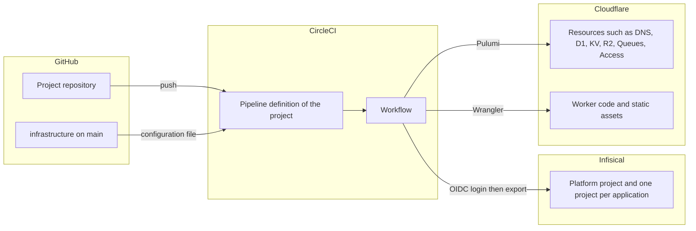
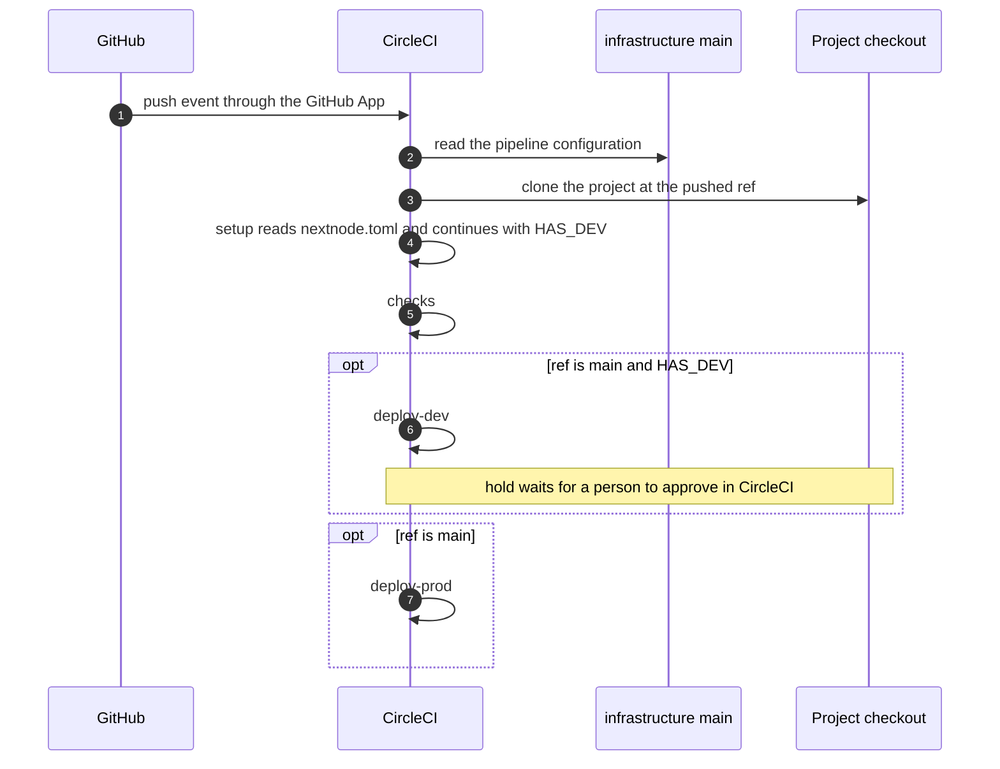
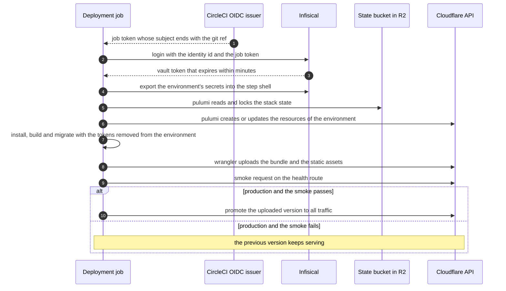

# Architecture

This page explains how a change in a NextNode project repository becomes a deployment on Cloudflare, which systems take part, what each boundary promises, and what a failure leaves behind. The rules for changing this repository are in [AGENTS.md](../AGENTS.md).

## Principles

Four choices shape everything below.

- **One source of truth.** The pipeline configuration lives in this repository on `main`. A project repository holds no CI file. It declares what it needs in `nextnode.toml` and exposes a handful of package scripts.
- **No machinery beyond the need.** Every mechanism in the chain exists because a cheaper one failed a concrete requirement. When a vendor adds the feature that made a workaround necessary, the workaround goes.
- **The trust perimeter is the human accounts.** A compromise of the GitHub, CircleCI, Infisical or Cloudflare account of a maintainer is a compromise of everything. The platform does not pretend to isolate projects from each other beyond that perimeter, so it never pays for isolation that the account model would undo.
- **No long-lived secret inside the pipeline.** A job proves who it is with a short-lived OpenID Connect (OIDC) token and trades it for a short-lived vault token. The only durable credentials are the Cloudflare API tokens, which sit in the vault.

## The parts

Each boundary carries a contract.

| Boundary | Contract |
| --- | --- |
| Project repository to CircleCI | A push on any branch starts a pipeline. The project is cloned at the pushed ref. The project supplies `nextnode.toml`, a pinned `packageManager`, and the scripts `lint`, `format:check`, `type-check` and `build`, plus `test` when it has tests. |
| This repository to CircleCI | The pipeline definition of every project reads its configuration file from `main` of this repository. CircleCI's GitHub App integration allows the configuration source and the checkout source to be different repositories. A merge here is a release to every project. |
| CircleCI to Infisical | Each job receives an OIDC token whose subject names the CircleCI organization, the project, the user who caused the run, the repository and the git ref. Infisical accepts it for one machine identity, bound to the organization and to the `main` ref of the organization's repositories, and returns a vault token that expires within minutes. |
| Job to Pulumi | Pulumi owns every Cloudflare resource it can express. The program reads `nextnode.toml`, keeps its state in an R2 bucket of the platform account, and exposes the identifiers the Worker needs as stack outputs. |
| Job to Wrangler | Wrangler does only what Pulumi cannot do cleanly, which is bundling the Worker and uploading code and static assets. It reads the binding identifiers Pulumi produced. It is the Cloudflare-specific port of the deployment. Another target, such as AWS, gets its own port behind the same job. |
| Job to the project | The project's own commands run for install, build and migrations, as a second user of the job. They receive the public variables and the application's secrets of the environment being deployed, and nothing else: not the platform's credentials, not anything that would let them talk to the vault. |

## The pipeline

Rules that the diagram encodes:

- **A branch gets checks and nothing else.** No job on a branch uses a vault identity, so a pull request from any author can run without exposing anything. Pull requests merge into `main` by squash, under the organization rulesets.
- **`main` is the only deployment branch.** There is no `develop` branch and no release tag. A merge deploys the development environment when the project declares one, then waits for approval, then deploys production. A project without a development environment goes to production on merge, with no approval step. That is the explicit choice for simple projects.
- **The project decides whether it has a development environment.** The `setup` job reads `nextnode.toml` and relaunches the rest of the pipeline with the `HAS_DEV` parameter, using CircleCI's dynamic configuration. A development environment with a database has its own cost and lifecycle, so it is not forced on every project.
- **The approval is the only manual step.** Anyone who can approve in the CircleCI organization can release. Restricting approval to a group is a paid CircleCI feature, so the organization membership is the control.

`checks` installs the pnpm version pinned in the project's `package.json`, installs with a frozen lockfile, then runs the project's lint, format check and type check, and its tests when a `test` script exists. It enforces nothing of its own beyond the pin and the lockfile. The contract with a project is the set of scripts, not their content.

## The deployment job

One job, parameterized by the environment. It runs on CircleCI's Node image at a pinned tag, and installs the platform tools at exact versions into the platform user's home: Wrangler, the Infisical CLI, the configuration parsers, later Pulumi with its providers. CircleCI caches that installation under a key made of the versions, and the project's pnpm store under a key made of its lockfile, so a job spends its time on the project, not on downloads. Changing a tool version changes the key and rebuilds the cache once.

Three rules keep the secrets where they belong.

- **The vault token never leaves the step that obtained it.** Login and export happen in one shell. Nothing is written to the file CircleCI sources before each step.
- **Project code never sees the job token, nor the platform's credentials.** Project commands run as a second user, in a process that replaced the step shell without the OIDC variables. The variables are removed from every later step once the vault step has ended, the platform's secrets live in a file only the platform user reads, and root access ends before the first project command. A dependency with a lifecycle script, even one that leaves a process behind, finds neither token in its environment, in a file it may read, or in a process it may inspect.
- **Wrangler is the platform's, not the project's.** It runs as the platform user with the Cloudflare credential, on the Wrangler configuration the repository committed: the job keeps that copy aside before any project command runs, restores it and names it to Wrangler before deploying. A build command in that configuration is refused when the job reads it, because the build is the project's build script, run as the project user.
- **Nothing the project controls is evaluated by a shell.** The values of `nextnode.toml` and the results of a deployment travel between steps as JSON files owned by the platform user, never as lines of a sourced shell file.
- **An application's production secrets exist only in `deploy-prod`.** That job exports the application's production environment and no other. It runs on `main` only, after the approval when the project has a development environment, and straight after `checks` when it has none. Infisical cannot tell the two deployment jobs apart, because both tokens carry the same subject. The central configuration is what tells them apart, and only a pull request here can change it.

Development deploys directly to all traffic. Production uploads a version that receives no traffic, runs the smoke request against its preview URL, and promotes it only on success. The preview URL is the gate, so a production Worker keeps preview URLs enabled.

### What a failure leaves behind

| Failure | What is left |
| --- | --- |
| `checks` fails | Nothing deployed. The pull request shows the failing step. |
| Vault login fails | Nothing deployed. Either the identity binding rejects the ref, or the identity is not a member of the project. The step prints the Infisical error. |
| Pulumi fails part way | The stack state records what was created. The next run converges, because the program is declarative. The lock is released when the process ends. |
| Migration fails | Resources are up to date, the previous Worker still serves. The project's migration tool owns the recovery. |
| Development smoke fails | The development Worker has already been replaced, production is untouched. |
| Production smoke fails | The new version is uploaded but never promoted. The previous version keeps serving. |
| Approval never given | The pipeline stays on hold. Development is deployed, production is not. A later merge starts a new pipeline. |

## Secrets and identities

Infisical holds every value. Nothing secret is written in this repository, in a project repository, in CircleCI or in a pipeline log.

- **One platform project** holds what every deployment needs, in a single Infisical environment named `main`. That is the Cloudflare API token and account, the credentials of the state bucket, and the passphrase that encrypts Pulumi's secret outputs. One account serves every deployment environment, so a split by environment would hold the same values twice while every job could read both anyway.
- **One project per application**, named after the repository, with one Infisical environment per deployment environment, holds the application's own secrets. Locally, `infisical run --env development` replaces a dotenv file.
- **One machine identity**, Viewer of the platform project and of every application project. It logs in through OIDC Auth, bound to the CircleCI organization as audience and to a subject pattern that names the organization, the GitHub organization and the `main` ref. A pipeline on another ref gets nothing.

Why a single identity rather than one per environment or per repository. On Infisical's free plan, a role covers every environment of a project, and the mechanisms that would scope an identity to one environment are paid or retired. Identities are billed per unit, humans and machines together. Splitting projects per environment would buy a boundary that the account model already undoes. So the identity sees everything, and the configuration decides what each job exports. Re-check this when the plan or the vendor changes, in the Infisical pricing page and in the access-control documentation.

Why the subject is the only binding. Infisical matches bound claims by splitting the claim name on dots, and CircleCI names every custom claim under a dotted prefix, such as the list of contexts a job used. Those claims are unreachable, so only the subject and the audience are enforceable. The day Infisical can read them, binding the identity to a context would let the vault itself tell development from production.

Where values enter. A person types them in the Infisical dashboard, or pipes them to the CLI from a prompt that does not echo. They never pass through a chat, a command argument, a log or a file in a repository. Verification reads names, never values.

Durable credentials and their rotation:

| Credential | Lives in | Rotated when |
| --- | --- | --- |
| Cloudflare API token, allowed on every product of the account but not on what manages the account itself, such as tokens, members, settings and billing | Platform project | A maintainer leaves, a value was displayed, or on a fixed schedule. Cloudflare offers no OIDC federation, so this is the one long-lived secret of a deployment. |
| CircleCI personal token used to register projects and to run the canary | The operator's own vault, never a project the machine identity can read | Same triggers. It is never needed by a pipeline, and a job that could read it would control the CI. |
| State bucket credentials and Pulumi passphrase | Platform project | Same triggers. Rotating the passphrase re-encrypts the stacks. |

## The project's contract

`nextnode.toml` is the only input a project supplies besides its scripts. Its keys are fixed by the Pulumi program, which is their reference. In outline, it names the project and its Infisical project, says what kind of deployment it is and where the Worker lives, names the health route and the optional migration command, lists the resources to create by kind, and declares each environment with its domain. The presence of a development environment is what turns `HAS_DEV` on. The file never holds a secret value.

## Registering a repository

Registration is a script in this repository, run once per repository by a maintainer. It is idempotent so it can be rerun after a partial failure. By role, it:

1. creates the CircleCI project, a pipeline definition whose configuration source is this repository's file on `main` and whose checkout source is the new repository, and a trigger on all pushes;
2. creates the Infisical project named after the repository with its environments, and adds the machine identity as Viewer;
3. leaves `nextnode.toml` to the project, which the standards tooling writes.

Until the script exists, the same steps are done by hand against the APIs. The identifiers of the shared resources it needs are listed at the end of this page.

## Decisions

| Decision | Reason | Rejected |
| --- | --- | --- |
| CircleCI with the configuration in this repository | The only CI of the shortlist whose GitHub App integration runs a configuration from another repository against the project's checkout, so projects hold no CI file. | GitHub Actions reusable workflows, which still need a caller file in each repository and whose required-workflow rulesets cover pull requests only. |
| Pulumi from the first deployment | DNS ships with the first Worker, databases follow, and the same program will drive AWS. | Wrangler alone, which is Cloudflare-only and imperative for resources. |
| Wrangler kept for the bundle and the assets | Pulumi can create a Worker, but uploading static assets through it means redoing Wrangler's upload protocol by hand. | Pulumi-only Worker deployment. |
| No CLI or npm package in projects | A project should not depend on a tool to be deployable. The configuration carries the tooling, at pinned versions. | A published pipeline CLI, as the previous platform had. |
| Pinned tools in a cache rather than a platform image | The same determinism, with no registry, no push credential and no digest to bump in a second pull request. | An image built from this repository and pinned by digest. Revisit if the toolchain grows past what an install step handles in seconds. |
| One pipeline on `main`, no `develop`, no tags | Trunk-based flow with one manual gate. Fewer refs, fewer rules to protect. | Production on tags, which would have let the vault distinguish the two environments by ref, at the cost of a second flow. |
| Dynamic configuration for the development step | The project decides whether it has a development environment, and CircleCI offers no other way to read a file before choosing jobs. | Forcing a development environment on every project. |
| One vault identity | Scoping by environment is paid on the vendor side, and the account model already makes projects share a fate. | One identity per environment or per repository. |
| Migrations run by the project's command in the deployment job | The platform does not know the project's migration tool. | A platform-owned migration step. |
| The previous platform is documentation only | Its workflows and CLI are not consumed by anything. Its secrets model and its lessons inform this page. | Porting it. |

## Constraints verified against the vendors

These are the facts that forced the decisions above. Each names where to look when something behaves differently.

| Fact | Consequence | Re-check in |
| --- | --- | --- |
| CircleCI's second-generation OIDC subject ends with the repository and the git ref, and custom-webhook runs carry no ref. | The subject binding can pin `main`. API-triggered runs must be checked before relying on them. | CircleCI documentation, OpenID Connect tokens. |
| Every CircleCI job receives the OIDC token, with or without a context. | No context is used. The identifiers a job needs are written in the configuration. | CircleCI documentation, OpenID Connect tokens. |
| A pipeline whose configuration comes from another repository is not displayed in the CircleCI configuration editor, and `CIRCLE_REPOSITORY_URL` is empty. | Read the file from this repository. Take the repository from the checkout, not from that variable. | CircleCI documentation, GitHub App pipelines. |
| CircleCI reserves `<<` in configuration files. | A shell heredoc inside a `run` step must escape its marker as `\<<`. | CircleCI documentation, configuration reference. |
| On the `cimg` images, a global npm install needs `sudo`, and `CI=true` makes `pnpm install` frozen by default. | The install step says so. Error messages at that step point here. | The image documentation. |
| On the `cimg` images sudo is passwordless, the CircleCI agent that holds the job token runs as root, and a process may read the environment and overwrite the files of any process of its own user. | Project commands run as a second user created in the job, through `exec`; the OIDC variables are unset at the head of `BASH_ENV` after the vault step; root access ends once the tools are installed and sudo keeps one rule, to become the project user. | The image documentation, and a probe step on the canary that lists which processes expose the token. |
| Infisical reads bound claims through dotted paths and ignores array values. | Only `sub` and `aud` can be bound for CircleCI. | Infisical source, OIDC auth service and the dot-access helper. |
| On the Infisical free plan, custom roles are refused with a plan error, additional privileges are refused for recent projects as a retired feature, folder access controls are paid, and identities are billed per unit. | A free identity sees every environment of each project it belongs to. | Infisical pricing page and access-control documentation. |
| Infisical ignores a request that only turns delete protection off. | To delete a protected identity, send the name together with the flag, then delete. | Infisical source, identity service. |
| Cloudflare offers no OIDC federation for its API. | An API token stays in the vault and is rotated. | Cloudflare API documentation. |
| Wrangler calls git in the working directory for version metadata, and git runs commands the repository configures, such as hooks or a file system monitor. | After the project user is created, the platform user's git points at no repository, so Wrangler finds none and runs nothing from the checkout. | Wrangler source, the deployment metadata helpers, and git configuration documentation. |
| Wrangler refuses to upload a version of a Worker that was never deployed, and a version carries no change of routes or domains. | The first production deployment of a Worker goes through a direct deployment, with nothing serving yet. Routes and domains are Pulumi's, never a version's. | Wrangler documentation on versions and gradual deployments. |

## Open points

Each is validated on the canary repository before it reaches a real project.

- Dynamic configuration when the configuration source is another repository, through the continuation API. It is what lets a project without a development environment reach production straight after the checks. The fallback, a static workflow where the development job halts at once when the project has no development environment, still routes such a project through the approval.
- Pulumi's S3 backend against R2, with path-style addressing and the automatic region. The lock is a file, so one deployment at a time per stack.
- The scopes of the Cloudflare API token.

## Identifiers of the shared resources

These live nowhere else yet. The registration script becomes their home when it exists.

| Resource | Identifier |
| --- | --- |
| CircleCI organization `Nextnode` | `d5f82c19-9496-4d58-bc57-6ab0c112163f`, slug `circleci/TRU8GsHNL2QX13BVQE2UK8`. OIDC issuer `https://oidc.circleci.com/org/d5f82c19-9496-4d58-bc57-6ab0c112163f` |
| This repository's GitHub id, used as configuration source | `1431173996` |
| Infisical organization | `5082d2f8-c593-4058-8643-11f685d6d7d2` |
| Infisical platform project `nextnode-platform` | `721a5f71-3801-40e2-a06d-a4a9b431e1c7` |
| Infisical machine identity of the pipeline | `17af2913-5649-4771-b149-aa9bf50ff39d` |
| Canary: GitHub repository `NextNodeSolutions/canary` | GitHub id `1433288639`, CircleCI project `01fc0b41-1871-4e49-85f1-6780a36e5b23`, pipeline definition `3b27438e-17b8-41f4-8e7e-372b32323712`, trigger `0ab5440e-27ab-49de-aa0f-bce23f906830` |
