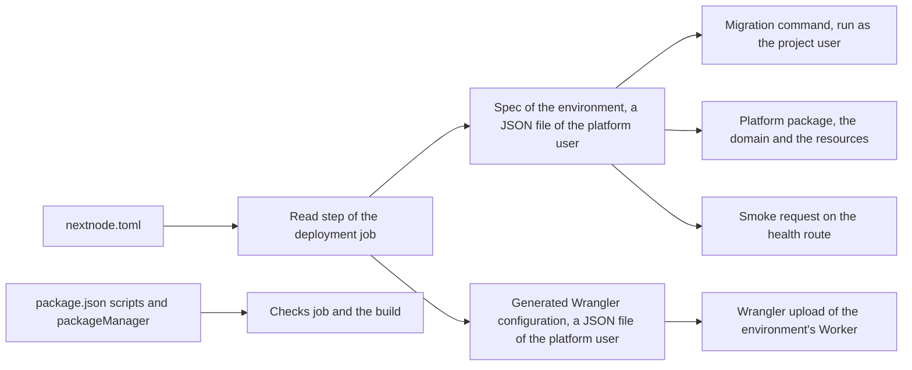
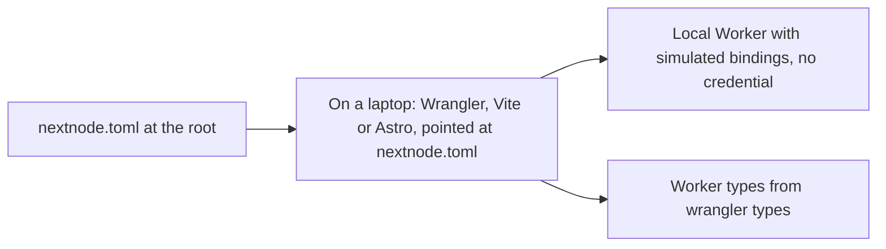

# The project's contract

This page lists what a project repository supplies to the pipeline and how a mistake is reported. The pipeline itself is explained in [architecture.md](architecture.md).

The read step runs once per deployment job, before any project code. It reads `nextnode.toml`, refuses what the platform cannot accept, and writes two files: the spec of the environment and the Wrangler configuration of its Worker. Every later step reads those files, never `nextnode.toml` again, so a project script that rewrites it during the build changes nothing.

## nextnode.toml

The file lives at the repository root and holds names only, never a secret value.

| Key | Role | When absent |
| --- | --- | --- |
| `project.name` | Names the project everywhere the platform keeps state for it, including the Pulumi project, and names the Worker of each environment `<project.name>-<environment>`. Lowercase letters, digits and dashes, short enough for that Worker name to stay within Cloudflare's 63 characters. | Refused. |
| `project.infisical_project` | Identifier of the Infisical project that holds the application's secrets, one environment per deployment environment. | Refused. |
| `deploy.health` | Route the pipeline requests after each upload. It must answer with a success status on a fresh deployment, even against an empty database. | The root route. |
| `deploy.migrate` | Command that applies the project's migrations, run as the project user after the build with the application's secrets in its environment. The platform never guesses a migration tool. | No migration step. |
| `environments.development.domain` | Hostname of the development environment, attached to its Worker as a custom domain. The zone must belong to the platform's Cloudflare account. | Refused when the section exists. When the whole `environments.development` section is absent, the project has no development environment: the development job halts and the pipeline waits for the approval. |
| `environments.production.domain` | Hostname of the production environment. | Refused. |

The presence of `environments.development` is the project's choice. A development environment with a database has its own cost and lifecycle, so the platform does not force one.

## The Wrangler keys

`nextnode.toml` is also the Worker's Wrangler configuration. Every top-level key outside `project`, `deploy` and `environments` is Wrangler's own, with Wrangler's meaning: `main`, `assets`, `compatibility_date`, `vars`, an `env.<environment>` section for what differs per environment. A project keeps no other Wrangler file. Paths are relative to the repository root, where the file lives.

Locally, the tools take the file by path: `wrangler dev --config nextnode.toml`, `wrangler types --config nextnode.toml`, or the `configPath` option of the Cloudflare Vite plugin and of the Astro adapter. Wrangler warns about the NextNode tables it does not know and reads the rest. Types are generated by Wrangler itself.

In the deployment job, Wrangler runs with the platform's Cloudflare credential, so it never reads the file from the checkout. The read step generates its configuration from the committed file before any project command runs, into the platform user's directory, and Wrangler runs from there. That configuration holds the environment alone: each key of `env.<environment>` replaces the top-level key of the same name, whole, so a `vars` table in the section replaces the top-level one.

The step accepts only the keys that describe the Worker's own code and runtime, at the top level and in the environment's section: the entry point and how it is compiled, the compatibility settings, the static assets, `vars` and `define`, cron triggers, Durable Objects of the Worker's own classes, the AI, browser and images bindings, observability, limits, placement and the preview URL switches. A refusal prints the accepted keys. Every other key is refused, for one of these reasons:

- **It names the Worker or the account**, such as `name` and `account_id`. The Worker of an environment is named `<project.name>-<environment>`, and the platform deploys to its own account. The platform package attaches the domain to that name, so it must be the one Wrangler uses.
- **It runs project code with the credential**, such as `build` and `containers`. The build is the project's `build` script, run as the project user.
- **It routes traffic or mail to the Worker**, such as `routes` and `addresses`. Domains come from `nextnode.toml` and are attached by the platform package after each upload. A route declared to Wrangler would be fought over by every deployment.
- **It binds to or creates another resource**, such as a database, a namespace, a bucket, a queue, a workflow, another Worker or another Worker's Durable Objects. Wrangler creates a missing resource on its own, outside Pulumi's state, and every project deploys into the same account, so a binding by name could reach another project's resource.
- **Wrangler added it after the platform last reviewed its keys.** A new key stays refused until the platform knows what it does with the credential.

A production Worker keeps preview URLs enabled. The pipeline checks a production version on its preview URL before promoting it, and fails the deployment when the upload yields none.

## The package manifest

The `packageManager` field pins pnpm as a plain version, with an optional integrity hash. A URL, a tag or a path is refused, because the pipeline installs what the field says, globally, before anything else.

The scripts the pipeline calls:

| Script | Called by | Required |
| --- | --- | --- |
| `lint`, `format:check`, `type-check` | The checks job, on every push. | Yes. |
| `test` | The checks job, when declared. | No. |
| `build` | The deployment job, as the project user, before the migrations and the upload. | Yes. |

The install is frozen: a lockfile that does not match the manifest fails the first step rather than installing something else.

## How a mistake is reported

A refusal of `nextnode.toml`, its NextNode keys or its Wrangler keys, happens in the read step, with a message that names the key or the rule, before any secret is fetched and before any project code runs. The other mistakes show in the step that meets them.

| Mistake | Where it shows |
| --- | --- |
| A missing or malformed key of `nextnode.toml`, a refused Wrangler key | The read step of the deployment job, which prints the key or the rule. The checks job does not read the file, so the error appears on `main` only. |
| An unpinned or malformed `packageManager` | The install step of the checks job, on the first push. |
| A lockfile out of date | The project's install step, on the first push. On `main`, the deployment job fails at the same step, before the build. |
| A domain whose zone is not in the platform's account | The resources step of the deployment job, from the platform package, after the upload: the Worker serves on its workers.dev URL and the domain is not attached. |
| A health route that does not answer | The smoke step. Development has already been replaced; a production version is never promoted. |
