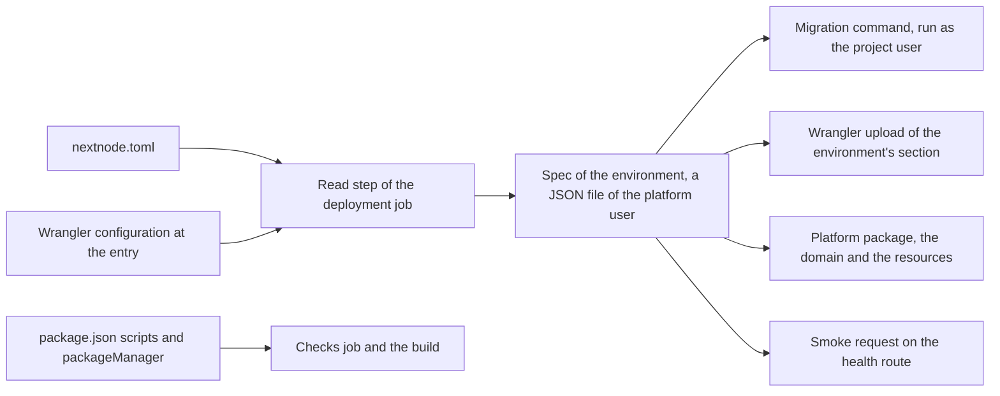

# The project's contract

This page lists what a project repository supplies to the pipeline and how a mistake is reported. The pipeline itself is explained in [architecture.md](architecture.md).

The read step runs once per deployment job, before any project code. It reads `nextnode.toml` and the committed Wrangler configuration, refuses what the platform cannot accept, and writes one spec for the environment. Every later step reads that spec, never the files again, so a project script that rewrites them during the build changes nothing.

## nextnode.toml

The file lives at the repository root and holds names only, never a secret value.

| Key | Role | When absent |
| --- | --- | --- |
| `project.name` | Names the project everywhere the platform keeps state for it, including the Pulumi project. Letters, digits, dots, dashes and underscores. | Refused. |
| `project.infisical_project` | Identifier of the Infisical project that holds the application's secrets, one environment per deployment environment. | Refused. |
| `deploy.entry` | Directory that holds the Wrangler configuration, relative to the root. | The root. |
| `deploy.health` | Route the pipeline requests after each upload. It must answer with a success status on a fresh deployment, even against an empty database. | The root route. |
| `deploy.migrate` | Command that applies the project's migrations, run as the project user after the build with the application's secrets in its environment. The platform never guesses a migration tool. | No migration step. |
| `environments.development.domain` | Hostname of the development environment, attached to its Worker as a custom domain. The zone must belong to the platform's Cloudflare account. | No development environment: the development job halts and the pipeline waits for the approval. |
| `environments.production.domain` | Hostname of the production environment. | Refused. |

The presence of `environments.development` is the project's choice. A development environment with a database has its own cost and lifecycle, so the platform does not force one.

## The Wrangler configuration

Wrangler runs as the platform user with the Cloudflare credential, on the configuration the repository committed. The read step keeps that copy aside before any project command runs, and the deployment restores it, so a build cannot alter what Wrangler reads. Four rules follow, each checked by the read step.

- **Exactly one configuration file at the entry**, in JSON, JSONC or TOML. Two files would leave Wrangler to choose.
- **A section per deployment environment**, under `env`. Wrangler deploys that section, and the Worker is named after it, or after the top-level name suffixed with the environment when the section gives no name. The platform attaches the domain to that Worker, so it needs the name to be the one Wrangler uses.
- **No build command.** The configuration is read with the platform credential, and a build command in it would run project code with that credential. The build is the project's `build` script, run as the project user.
- **No route and no custom domain.** Domains come from `nextnode.toml` and are attached by the platform package after each upload. A route declared to Wrangler would be fought over by every deployment.

A production Worker keeps preview URLs enabled. The pipeline checks a production version on its preview URL before promoting it, and fails the deployment when the upload yields none.

## The package manifest

The `packageManager` field pins pnpm as a plain version, with an optional integrity hash. A URL, a tag or a path is refused, because the pipeline installs what the field says, globally, before anything else.

The scripts the pipeline calls:

| Script | Called by | Required |
| --- | --- | --- |
| `lint`, `format:check`, `type-check` | The checks job, on every push. | Yes. |
| `test` | The checks job, when declared. | No. |
| `build` | The deployment job, as the project user, before the migrations and the upload. | Yes. |

The install is frozen: a lockfile that does not match the manifest fails the first step rather than installing something else.

## How a mistake is reported

Every refusal happens in the step that reads the input, with a message that names the key or the rule, before any secret is fetched and before any project code runs.

| Mistake | Where it shows |
| --- | --- |
| A missing or malformed key of `nextnode.toml`, a Wrangler configuration that breaks a rule above | The read step of the deployment job, which prints the key or the rule. The checks job does not read these files, so the error appears on `main` only. |
| An unpinned or malformed `packageManager` | The install step of the checks job, on the first push. |
| A lockfile out of date | The project's install step, on the first push. |
| A domain whose zone is not in the platform's account | The resources step of the deployment job, from the platform package, after the upload: the Worker serves on its workers.dev URL and the domain is not attached. |
| A health route that does not answer | The smoke step. Development has already been replaced; a production version is never promoted. |
