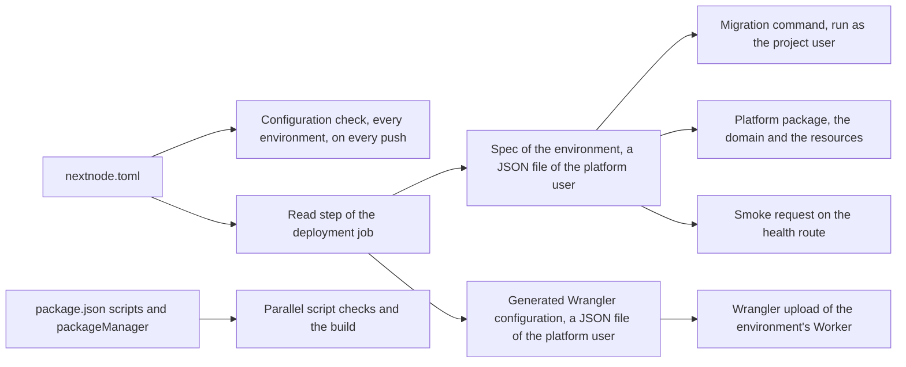
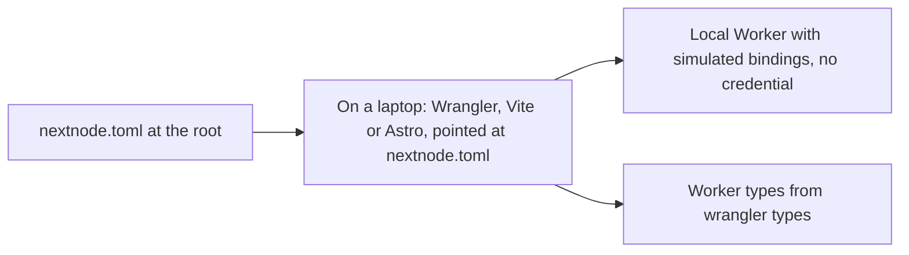

# The project's contract

This page lists what a project repository supplies to the pipeline and how a mistake is reported. The pipeline itself is explained in [architecture.md](architecture.md).

The file is read twice by the same program. On every push, the configuration check reads it for every environment and writes nothing, so a mistake fails the branch, not the deployment after the merge or the approval. The read step of each deployment job reads it again for its own environment, before any project code, refuses what the platform cannot accept, and writes two files: the spec of the environment and the Wrangler configuration of its Worker. Every later step reads those files, never `nextnode.toml` again, so a project script that rewrites it during the build changes nothing.

## nextnode.toml

The file lives at the repository root and holds names only, never a secret value. It does not name the project: the repository's name, as CircleCI checked it out, names the Pulumi project that holds the project's state and the Infisical project that holds its secrets. A value of the file could name another project's, so none does. The repository name also names the Worker of each environment, `<repository>-<environment>`, so it is made of lowercase letters, digits and dashes, short enough for that Worker name to stay within Cloudflare's limit.

| Key | Role | When absent |
| --- | --- | --- |
| `deploy.health` | Route the pipeline requests after each upload. It must answer with a success status on a fresh deployment, even against an empty database. | The root route. |
| `deploy.migrate` | Command that applies the project's migrations, run as the project user after the build with the application's secrets in its environment. The platform never guesses a migration tool. | No migration step. |
| `environments.development.domain` | Hostname of the development environment, attached to its Worker as a custom domain. The zone must belong to the platform's Cloudflare account. | Refused when the section exists. When the whole `environments.development` section is absent, the project has no development environment: the development job halts and the pipeline waits for the approval. |
| `environments.production.domain` | Hostname of the production environment. | Refused. |

The presence of `environments.development` is the project's choice. A development environment with a database has its own cost and lifecycle, so the platform does not force one.

## The Wrangler keys

`nextnode.toml` is also the Worker's Wrangler configuration. Every top-level key outside `deploy` and `environments` is Wrangler's own, with Wrangler's meaning: `main`, `assets`, `compatibility_date`, `vars`, an `env.<environment>` section for what differs per environment. A project keeps no other Wrangler file. Paths are relative to the repository root, where the file lives.

Locally, the tools take the file by path: `wrangler dev --config nextnode.toml`, `wrangler types --config nextnode.toml`, or the `configPath` option of the Cloudflare Vite plugin and of the Astro adapter. Wrangler warns about the NextNode tables it does not know and reads the rest. Types are generated by Wrangler itself.

In the deployment job, the file is never handed to Wrangler. The read step generates Wrangler's configuration from the committed file before any project command runs, into the platform user's directory, and the build cannot change it. That configuration holds the environment alone: each key of `env.<environment>` replaces the top-level key of the same name, whole, so a `vars` table in the section replaces the top-level one.

The schema of `nextnode.toml`, in the platform package, accepts only the keys that describe the Worker's own code and runtime, at the top level and in the environment's section: the entry point and how it is compiled, the compatibility settings, the static assets, `vars` and `define`, cron triggers, Durable Objects of the Worker's own classes, the AI, browser and images bindings, observability, limits, placement and the preview URL switches. A refusal prints the accepted keys. Every other key is refused, for one of these reasons:

- **It names the Worker, the project or the account**, such as `name`, `project` and `account_id`. The repository names all three, and the platform package attaches the domain to the Worker by that name, so it must be the one Wrangler uses.
- **It runs project code with the credential**, such as `build` and `containers`. The build is the project's `build` script, run as the project user.
- **It routes traffic or mail to the Worker**, such as `routes` and `addresses`. Domains come from `nextnode.toml` and are attached by the platform package after each upload. A route declared to Wrangler would be fought over by every deployment.
- **It binds to or creates another resource**, such as a database, a namespace, a bucket, a queue, a workflow, another Worker or another Worker's Durable Objects. Wrangler creates a missing resource on its own, outside Pulumi's state, and every project deploys into the same account, so a binding by name could reach another project's resource.
- **Wrangler added it after the platform last reviewed its keys.** A new key stays refused until the platform knows what it does with the credential.

Two rules hold for what the accepted keys reach:

- **Every path stays inside the repository.** The entry point, the TypeScript configuration, the module root and the assets directory resolve from the root to somewhere under it, and the bundle and the assets directory hold no link, hard link or pipe after the build: the platform copies them for the upload and refuses each. The upload reads with the platform credential, so a path or a link that reaches out of the checkout would upload a file of the platform. Module rules are globs evaluated under the module root and need no check of their own.
- **The bundle is the project's.** After the build, Wrangler bundles the entry point as the project user, with the generated configuration, and the upload takes a copy of the result as it is, without bundling and without source maps. An import of the project's code reaches what the project can read and nothing else. A Worker of static assets only has no entry point and no bundle.

A production Worker keeps preview URLs enabled. The pipeline checks a production version on its preview URL before promoting it, and fails the deployment when the upload yields none.

## The package manifest

The `packageManager` field pins pnpm as a plain version, with an optional integrity hash. A URL, a tag or a path is refused, because the pipeline installs what the field says, globally, before anything else.

The scripts the pipeline calls:

| Script | Called by | Required |
| --- | --- | --- |
| `lint`, `format:check`, `type-check` | Separate parallel jobs after configuration validation, on every push. | Yes. |
| `test` | Its own parallel job, when declared. | No. |
| `build` | The deployment job, as the project user, before the migrations and the upload. | Yes. |

The install is frozen: a lockfile that does not match the manifest fails the first step rather than installing something else.

## What a project command sees

Every script runs as a user of its own, in an environment built from a list rather than inherited from the job. The list is the contract: `PATH`, `HOME`, `CI`, the pnpm store location, and when they are set `NEXTNODE_ENVIRONMENT`, `CIRCLE_BRANCH`, `CIRCLE_SHA1`, `CIRCLE_BUILD_URL` and `CIRCLE_PROJECT_REPONAME`. In the deployment job the application's secrets of the environment being deployed are added, from the Infisical project named after the repository. Nothing else is there: not the job's tokens, not the platform's credentials, not a variable another step exported. A script that needs another variable of CircleCI's asks for the list to grow, through a pull request on this repository.

## How a mistake is reported

A mistake fails at the earliest job that can see it. A refusal of `nextnode.toml`, its NextNode keys or its Wrangler keys, happens in the configuration check, on the first push, with a message that names the key or the rule, before any project code runs. The other mistakes show in the step that meets them.

| Mistake | Where it shows |
| --- | --- |
| A file that is not valid TOML, a missing or malformed key of `nextnode.toml`, an environment the pipeline has no job for, no production environment, a refused Wrangler key, a path outside the repository, a repository name that cannot name a Worker | The configuration check, on the first push, which prints the key or the rule. |
| A link, a hard link or a pipe in the bundle or the assets, left by the build or committed | The copy step of the deployment job, after the build and before the upload, which names the file. |
| An entry point the bundler cannot resolve | The bundle step of the deployment job, run as the project user, with Wrangler's own message. |
| No Infisical project named after the repository, or two | The secrets step of the deployment job, before any project code runs. |
| An unpinned or malformed `packageManager` | The install step of each script check, on the first push. |
| A lockfile out of date | The project's install step, on the first push. On `main`, the deployment job fails at the same step, before the build. |
| A domain whose zone is not in the platform's account | The resources step of the deployment job, from the platform package, after the upload: the Worker serves on its workers.dev URL and the domain is not attached. |
| A health route that does not answer | The smoke step. Development has already been replaced; a production version is never promoted. |
