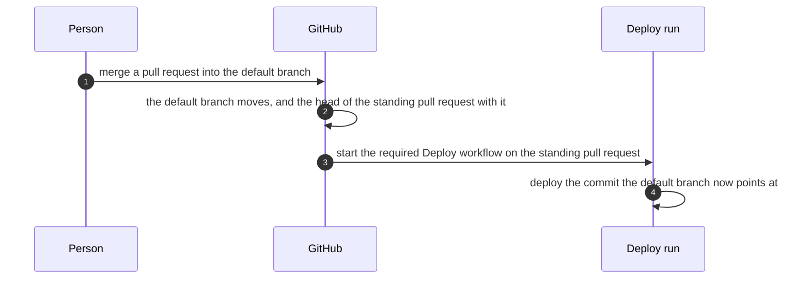
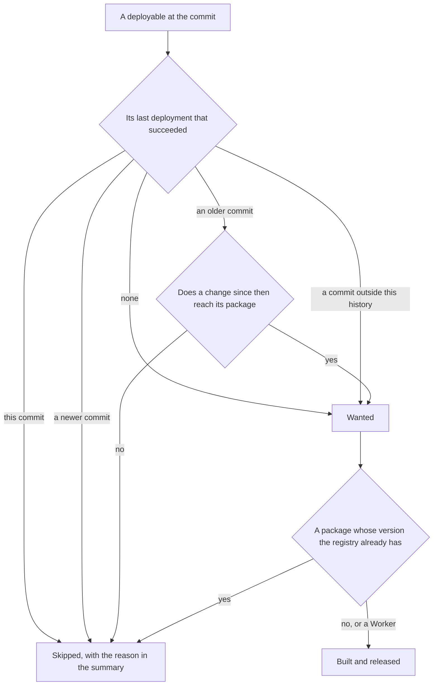
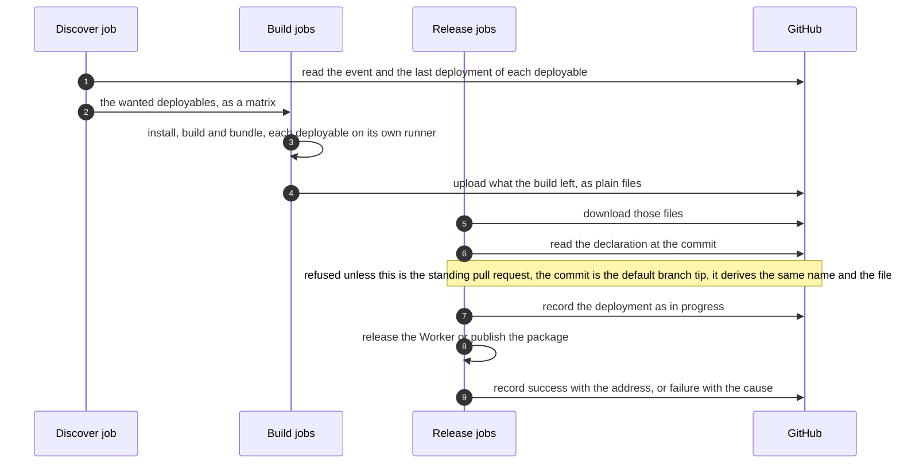
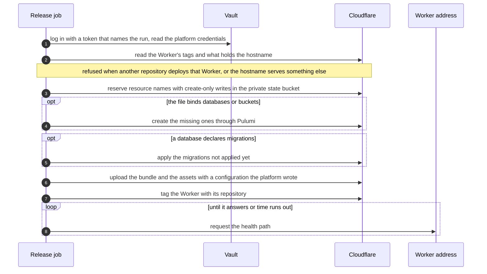
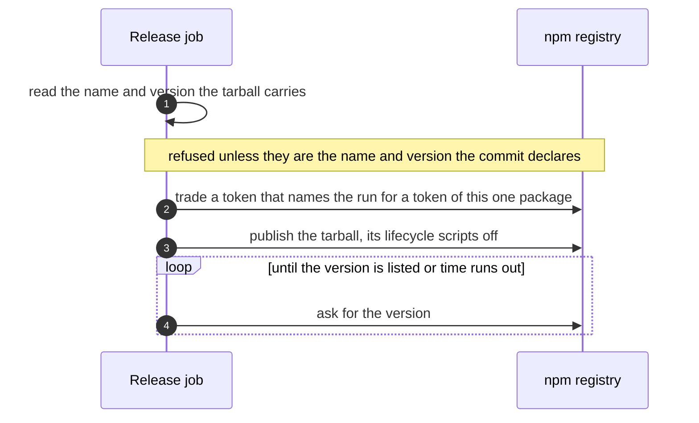
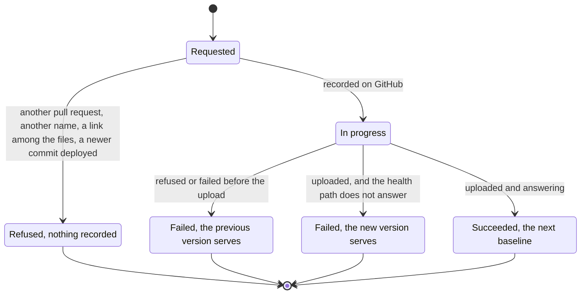

# Deployment

How a merge into a project's default branch becomes a Worker that answers or a package on the registry: which run starts, what each job holds, what gets deployed, and what a failure leaves. What a project writes to be deployed is in [nextnode-toml.md](nextnode-toml.md). The rules that keep it this way are in the root [AGENTS.md](../AGENTS.md).

## The standing pull request

A workflow that a ruleset requires starts on pull request events and on nothing else, and a project repository holds no workflow file that could listen to a push. So each repository keeps one pull request open for good, the standing pull request: from its default branch into `deployments`, a branch that never moves. Every merge into the default branch moves the head of that pull request, GitHub starts the `Deploy` workflow on it, and the run deploys the head commit, which is the commit on the default branch and never GitHub's merge of the two branches.

The alternative is one caller workflow per repository that listens to pushes. It costs the per-repository file that the rest of this repository exists to avoid, so it stays the fallback.

Nobody creates the standing pull request by hand. The `Deploy plan` workflow runs on every pull request into the default branch. Its second job creates `deployments` one commit behind the default branch and opens the standing pull request, when either is missing and a person opened the pull request from a branch of the repository. A ruleset forbids any update, deletion or forced push of `deployments`, so the standing pull request can never merge and its base never changes.

Runs of one repository queue behind each other and a run that started is never cancelled, because half a deployment is worse than a late one. A run still waiting can be replaced by a newer one, which loses nothing: a run deploys everything since the last deployment that succeeded.

| Situation                                                               | What happens                                                                                                                                                                                                                                 |
| ----------------------------------------------------------------------- | -------------------------------------------------------------------------------------------------------------------------------------------------------------------------------------------------------------------------------------------- |
| The standing pull request is closed                                     | A merge deploys nothing, and nothing can say so at that moment, because a required workflow does not run when a pull request closes. The next pull request into the default branch reopens it with a warning, and the next merge catches up. |
| A merge made with a workflow's own token, such as a scripted auto-merge | GitHub holds the Deploy run until a maintainer approves it. The deployment waits, it is not lost.                                                                                                                                            |
| The first run after the standing pull request was opened                | Held the same way, since a workflow token opened it. Approve it, or let the next merge by a person deploy.                                                                                                                                   |
| A pull request from any other branch into `deployments`                 | Discover fails and says to close it. It deploys nothing and cannot merge.                                                                                                                                                                    |
| The default branch has a single commit                                  | Nothing can stand one commit behind it yet. The pull request after the first merge opens the standing one.                                                                                                                                   |
| The gap between the two branches grows with every merge                 | GitHub keeps starting the run. An organization administrator can lift the lock and delete `deployments`, and the next pull request recreates it one commit behind.                                                                           |

Holding a run that a workflow token caused is the closed side of a choice. Unattended merges, such as Dependabot auto-merge, therefore wait for one approval. The upgrade is a merger that uses the token of a GitHub App, whose events GitHub does not hold. It is not proven here and no such App exists.

## The jobs and what each holds

| Workflow      | Runs on                                | Job                            | What it does with the project                  | What it holds                                            |
| ------------- | -------------------------------------- | ------------------------------ | ---------------------------------------------- | -------------------------------------------------------- |
| `Deploy plan` | A pull request into the default branch | Plan                           | Reads its files, runs its package manager      | A token that only reads                                  |
|               |                                        | Open the standing pull request | Nothing: no checkout, no install               | A token that writes branches and pull requests           |
| `Deploy`      | The standing pull request              | Discover                       | Reads its files, runs its package manager      | A token that only reads                                  |
|               |                                        | Build, one per deployable      | Installs it, builds it, bundles it             | A token that only reads                                  |
|               |                                        | Release, one per deployable    | Nothing: no checkout, no install, no execution | A token that records deployments, and the run's identity |

The split is the security model. A job either runs the project or holds something that writes, never both. Plan says on each pull request what a merge would deploy and why, so the reviewer reads the deployment before approving the change.

On a pull request that is not the standing one, `Deploy` asks for no build and no release and ends green, and a Release job started anyway refuses before it reads anything.

## What a run deploys

A deployable is one `nextnode.toml` with the `package.json` beside it. It is named once, after the repository, and in a workspace after the repository and the package. That name is the Worker, the GitHub environment that records its deployments, the Pulumi stack that holds its resources and the artifact that carries its build.

The baseline is per deployable and it is the last deployment that succeeded, read from GitHub's deployment records. Each success must name a GitHub run of the ruleset-required Deploy workflow with the same commit and a successful Release job for this deployable. A project-authored workflow cannot supply that proof. Records and statuses are paginated until a verified success or the end of history. A deleted proof causes another build, never a skipped release.

The pipeline keeps no release history of its own. A run that failed, was cancelled or never started therefore heals itself. Before requesting credentials, Release separately checks that its commit is still the default branch tip. A superseded run refuses even if deployment records are forged or deleted. A newer merge during a release queues behind that release and then deploys the newer commit.

A change reaches a package when it touches the package or one it depends on, transitively, through pnpm's own filter. A root file that every package reads reaches all of them, and a single-package repository is always reached. Unlike the checks, a deployment ignores no file: Markdown is content for a site.

A package is published once per version. A change that keeps the version publishes nothing, and the summary says to change the version.

## A Deploy run

Builds run in parallel, one runner per deployable, and so do releases. One deployable failing stops no other.

A build runs the project's `build` script through the same executor the checks use, then stages what a release needs: the Worker's code as Wrangler bundles it without uploading and without an account, the assets directory, the migrations of each database, or the tarball that `pnpm pack` writes. A single package without a `build` script has nothing to build and its files are staged as they are. Declared source paths resolve inside the deployable, and asset and migration directories with links or special files are refused. Copying preserves a link created during the copy so Release can refuse it.

### Releasing a Worker

The release writes Wrangler's configuration itself. The file's own keys keep their meaning, the names and ids come from the repository, and the code is the bundle the build made, uploaded without being bundled again. So what serves is byte for byte what the Build job produced.

Databases and buckets go through Pulumi, with one project per repository and one stack per deployable, because they outlive a deployment and need a record of what exists. The state lives in a bucket of the platform's Cloudflare account, encrypted with a passphrase from the vault. A binding removed from the file leaves its database or bucket in the account for a person to delete: a release creates data stores and never deletes one. A binding added back takes its store back with its data: the release finds the store under the name its claim reserves and imports it into the stack instead of creating it again.

Before provisioning or uploading, the release reserves each Worker, hostname, database and bucket name in the private state bucket. A claim names the immutable GitHub repository id and the deployable. R2's [conditional writes](https://developers.cloudflare.com/r2/api/s3/conditional-operations/#atomicity) create it only when absent, so competing repositories cannot both reserve a name. A retry by the same owner is accepted. An uncertain write fails the release instead of assuming the name is free.

Claims remain after a failed release or a removed binding. Reassigning a name requires a separate owner-approved operation, not an edit of `nextnode.toml`. These claims coordinate this pipeline, not manual account changes or other deployment systems.

Renaming the repository or a package renames its deployables, because every name derives from them. The next release deploys a new Worker, stack, databases and buckets beside the old ones, which keep serving and keep their data until a person deletes them. A declared domain stays reserved to the old Worker, so the release refuses it until that owner-approved operation moves it.

A deployment is done when what was deployed answers. Any answer below a client error counts, a redirect included, and a hostname attached for the first time is given the time its certificate takes.

### Publishing a package

The registry stores no token for the platform and the vault holds none. Each package names its repository and the `Deploy` workflow as its trusted publisher, and the registry trades the run's identity for a token that publishes that package alone for a few minutes. A package release never logs in to the vault.

### The states of a deployment

Every failed state leaves the baseline where it was. Merging a fix, or re-running the failed jobs of the run, deploys everything since the last success. A re-run of the failed Release jobs uploads the build the run kept, for as long as the workflow keeps its artifacts; past that, re-run all jobs.

### What a failure leaves

| Outcome                                                              | What is left                                                                                            | Next action                                                        |
| -------------------------------------------------------------------- | ------------------------------------------------------------------------------------------------------- | ------------------------------------------------------------------ |
| A `nextnode.toml` or its `package.json` is refused                   | Discover fails with an annotation on the file that names the key. Nothing is built.                     | Fix the file.                                                      |
| A build fails                                                        | That deployable is not released. The others are.                                                        | Fix the build.                                                     |
| The release is refused before it records anything                    | Nothing changed anywhere.                                                                               | What the message says.                                             |
| A run is started after another commit becomes the default branch tip | It refuses before dependency installation or credentials and records nothing. What serves is unchanged. | Nothing.                                                           |
| The vault refuses the login                                          | A failed deployment record. Nothing changed in Cloudflare.                                              | The run is not the `Deploy` workflow on the standing pull request. |
| Another repository deploys the Worker, or the hostname is taken      | A failed record. Existing Workers, DNS and data stores stay unchanged. Any new ownership claims remain. | Rename the package, or choose another domain.                      |
| Provisioning stops midway                                            | What was created stays and the state records it. The previous version serves.                           | Re-run the failed jobs.                                            |
| A migration fails                                                    | The migrations applied before it stay applied. The previous code serves on that database.               | Merge a fixed migration.                                           |
| The upload fails                                                     | The migrations are applied. The previous version serves.                                                | Re-run the failed jobs.                                            |
| The health path does not answer                                      | The new version serves and is recorded as failed. Nothing rolls back by itself.                         | Merge a fix, or roll back to the previous version in Cloudflare.   |
| The registry trusts no publication from the run                      | Nothing is published.                                                                                   | Set the package's trusted publisher, as the message says.          |
| The registry accepts the version and does not list it in time        | The deployment succeeded and the summary says the version is not listed yet.                            | Nothing.                                                           |

Migrations are applied before the code that needs them, so a migration must also suit the version that still serves while the upload runs, and after it if the upload fails.

### What a run says

Each job writes a summary. Discover lists every deployable with whether it deploys and why, and names the revision of the program that decided. A release that succeeded gives the address, the commit, the version and what answered the health path, or the package and its page. A release that failed gives the cause and the next action. GitHub's environment of each deployable shows what serves, with a link to the address and to the run.

## Setting up a repository

1. The repository's root `package.json` declares what the checks already need, and each deployable has its `nextnode.toml`.
2. An organization administrator adds the repository to the include list of the ruleset that requires `Deploy plan` on pull requests and of the ruleset that requires `Deploy` on `deployments` and locks that branch. A repository that only publishes packages needs both as well: a publication is a release.
3. The next pull request into the default branch that a person opens creates `deployments` and the standing pull request. Its first run waits for one approval.
4. A repository that deploys a Worker has a default branch named `main` and the token subject format with immutable ids, which GitHub gives every repository created recently and which an older one opts into in its settings. The vault admits on both.
5. A package exists on the registry before its first release, since the registry attaches a trusted publisher to an existing package. An owner of the scope publishes it once by hand, then names the repository and the workflow file `deploy.yml` as its trusted publisher, with direct publishing allowed. The package's `repository` field names the repository.

Nothing else is created by hand. The first release creates the Worker, its hostname, its databases and buckets and its GitHub environment.

## Trust boundary

| Trusted                                                                                                                                                     | Untrusted                                                                                                                                    |
| ----------------------------------------------------------------------------------------------------------------------------------------------------------- | -------------------------------------------------------------------------------------------------------------------------------------------- |
| The Release job and the job that opens the standing pull request, the program at the workflow's commit with its locked dependencies, the event GitHub wrote | The project: its code, its dependencies and their lifecycle scripts, its `nextnode.toml`, its package names, and every file its build leaves |

The boundary stands between a repository and the platform, and so between one repository and another. Two packages of one repository are one side of it.

What the trusted side holds:

| Credential                                                      | Held by                          | Lives               | Reaches                                                       |
| --------------------------------------------------------------- | -------------------------------- | ------------------- | ------------------------------------------------------------- |
| A repository token that only reads                              | Plan, Discover, Build            | The job             | Repository content, deployment records and release-run proofs |
| A repository token that writes branches and pull requests       | Open the standing pull request   | The job             | The repository                                                |
| A repository token that records deployments                     | Release                          | The job             | The repository's deployment records                           |
| The run's identity, which asks GitHub for tokens naming the run | Release, inside the program only | The job             | Any service that admits this run                              |
| The vault's access token                                        | Release of a Worker              | Minutes             | The platform's secrets, read only                             |
| The Cloudflare token and the state passphrase                   | Release of a Worker              | Stored in the vault | The whole Cloudflare account, and every project's state       |
| A registry token                                                | Release of a package             | Minutes             | One package                                                   |

The Cloudflare token reaches the whole account, so the program is what confines a project to its own resources:

- **A file names no resource.** It has no key for a Worker name, an account, a database id or a bucket name. The program derives every name from the repository and the package.
- **A Worker carries the repository that deploys it**, as a tag, and a release uploads over no Worker that carries another repository's. Two repositories can derive the same name, and the account has one namespace for all of them. A Worker made before the pipeline carries no tag and is taken by the first release to its name.
- **A hostname is taken only when nothing holds it**: no other Worker and no A, AAAA or CNAME record, in a zone of the account. Mail and verification records stay beside the Worker.
- **Names are reserved before account changes.** Create-only R2 records bind Worker, hostname, database and bucket names to an immutable repository id and deployable. Reservations do not expire, so a slow release cannot lose its reservation to another project.
- **A tarball is published only as the package and version the commit declares.**

What crosses from the project into the Release job, and how it is taken:

| What crosses                       | How it is taken                                                                                                                                                                                                              |
| ---------------------------------- | ---------------------------------------------------------------------------------------------------------------------------------------------------------------------------------------------------------------------------- |
| The matrix entry Discover wrote    | As a request. Its directory must be a path inside the repository, and the name must be the one the commit derives for that directory.                                                                                        |
| `nextnode.toml` and `package.json` | Read again at the commit through GitHub's API. Unknown `nextnode.toml` keys are refused. Manifest fields needed for deployment are decoded. Neither is read from the build's files.                                          |
| The files the build left           | As data. Anything that is neither a file nor a directory is refused. The bundle is uploaded without being bundled, the migrations run against the deployable's own databases, the tarball is published with its scripts off. |
| The event                          | GitHub wrote it and the project cannot. The jobs that hold something decide from it alone which pull request they serve.                                                                                                     |

How each channel to a credential is closed:

| Channel                        | Closed by                                                                                                                                                                                                                                                                                                                 |
| ------------------------------ | ------------------------------------------------------------------------------------------------------------------------------------------------------------------------------------------------------------------------------------------------------------------------------------------------------------------------- |
| The project's own processes    | None runs in a job that holds something that writes. That closes the environment, the process tree, sourced files and privilege at once.                                                                                                                                                                                  |
| The environment of a tool      | The program reads each token once and removes it from its own environment. Wrangler and npm start with the variables the program names and no other. Pulumi's SDK hands its CLI the job's remaining variables beside the ones the program names, and none of them is a token by then. The run's identity reaches no tool. |
| Configuration a tool reads     | Wrangler and npm run in a directory the program made, on a configuration the program wrote and names explicitly. A packed manifest carrying `publishConfig` is refused before any registry token is requested.                                                                                                            |
| What a tool spawns             | Wrangler uploads a finished bundle and runs no build command. npm publishes with lifecycle scripts off. Pulumi runs a program the platform wrote.                                                                                                                                                                         |
| The program's own dependencies | Installed from the program's lockfile, by the pnpm its manifest pins, with lifecycle scripts off, after the program left the project tree. The Pulumi CLI is downloaded at the version the program pins and installed only when its archive matches the pinned digest. The Release job restores no cache.                 |
| Shared places                  | The Release job starts on a fresh runner. The only thing of the project on its disk is the downloaded files, and the program works in directories it creates.                                                                                                                                                             |
| Shell evaluation               | Every value travels as JSON that a decoder reads or as an element of an argument array. No `run` line names a project value.                                                                                                                                                                                              |
| Output                         | Every credential is masked before use and none is printed.                                                                                                                                                                                                                                                                |
| Network                        | Outside the perimeter. The jobs that run the project reach the network and hold nothing worth sending.                                                                                                                                                                                                                    |

The vault admits a run by the claims of the token GitHub signs for it, never by a stored secret: the organization, the pull request event, the two branches of the standing pull request, and this repository's `Deploy` workflow file on its default branch as the run's workflow. Every pull request of a repository shares one token subject, so the subject alone would admit too much. The workflow claim is what a project cannot forge, because only a ruleset can make another repository's file the workflow of a run.

Two limits are stated rather than closed. A re-run uses the program of its first attempt, so a run older than a fix is not protected by it. And adding a repository to the ruleset is what admits it to the vault, so the include list is an access list.

### Probes

A guarantee is checked by an attack that must fail, on the canaries, after any change to these jobs.

| Guarantee                                               | Probe                                                                                                                                            |
| ------------------------------------------------------- | ------------------------------------------------------------------------------------------------------------------------------------------------ |
| Only the standing pull request deploys                  | Open a pull request from another branch into `deployments`. Discover fails, no build and no release start, no deployment is recorded.            |
| Competing repositories cannot reserve the same resource | Start concurrent create-only claims for the same name under different owners. Exactly one succeeds and the other refuses without replacing it.   |
| A tarball cannot configure authenticated npm            | Pack a manifest with `publishConfig` containing proxy and TLS settings. Reading it refuses before requesting a token.                            |
| The vault admits the Deploy workflow alone              | The single-package canary keeps a workflow of its own that asks for the Deploy login and passes only when the vault refuses.                     |
| An old run deploys nothing over a newer commit          | Re-run the failed or finished Release job of an older run after a newer one succeeded. It refuses and records nothing.                           |
| A selection reaches only what changed                   | Merge a change to one app of the workspace canary, then to its shared package. The first releases that app, the second its dependents.           |
| A deployment heals                                      | Close the standing pull request, merge, open a pull request. The warning appears, the standing pull request is reopened, the next merge deploys. |
