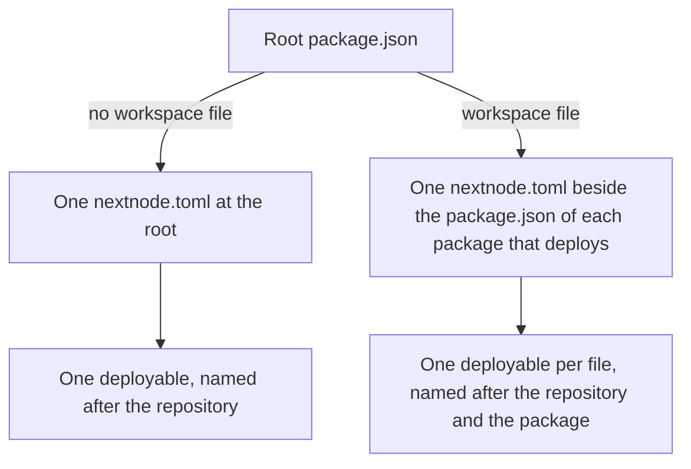

# nextnode.toml

What a project writes to be deployed: where the file lives, the keys it takes, the names the platform derives from it, and how a mistake is reported. How the file becomes a deployment is in [deployment.md](deployment.md).

## Where the file lives



One file is one deployable: a Worker or a package. A single-package repository declares at its root. A workspace declares in its packages and never at its root, because the root is a dependency of every package and a root declaration would deploy on every change. A repository with no `nextnode.toml` deploys nothing and its runs are green.

The file is the only thing a project adds. The repository's root `package.json` already carries what the checks need, and the `package.json` beside each file gives the deployable its name, its `build` script and, for a package, its version.

## A Worker

```toml
main = "src/worker.ts"
compatibility_date = "2026-11-01"

[assets]
directory = "dist"

[[d1_databases]]
binding = "DB"
migrations_dir = "migrations"

[[r2_buckets]]
binding = "BUCKET"

[environments.production]
domain = "api.example.com"

[deploy]
health = "/health"
```

The Worker keys are Wrangler's own, with Wrangler's meaning, so the file is also the Worker's local configuration: `wrangler types --config nextnode.toml` writes the types of its bindings, with one warning for the tables Wrangler does not know.

| Key                                                         | Read as                                                                                         |
| ----------------------------------------------------------- | ----------------------------------------------------------------------------------------------- |
| `main`                                                      | The entry of the Worker's code. Without it the Worker serves static assets only.                |
| `compatibility_date`                                        | Required, a date.                                                                               |
| `compatibility_flags`                                       | A list of Wrangler's flags.                                                                     |
| `[assets]` `directory`                                      | The directory of static files, as the build leaves it.                                          |
| `[assets]` `binding`, `not_found_handling`, `html_handling` | Wrangler's options for assets.                                                                  |
| `[vars]`                                                    | Plain values the Worker reads, safe to commit. The file has no key for a secret.                |
| `[[d1_databases]]` `binding`                                | A database the Worker binds, created on the first release.                                      |
| `[[d1_databases]]` `migrations_dir`                         | The directory of its migrations, applied before each upload.                                    |
| `[[r2_buckets]]` `binding`                                  | A bucket the Worker binds, created on the first release.                                        |
| `[environments.production]` `domain`                        | The hostname the Worker answers at. Without it the Worker answers at its `workers.dev` address. |
| `[deploy]` `health`                                         | The path a release requests to decide the deployment answers. The root path when absent.        |

A file needs `main`, `[assets]` or both. Every declared path resolves inside the file's directory. Asset and migration directories contain no links or special files. A binding is written in capitals, digits and underscores and ends with a capital or a digit, since the name of its database or bucket ends the same way. A Worker of static assets binds nothing, since it has no code to bind to.

Three things a Wrangler file would name are absent on purpose: the Worker's name, the account, and the id or name of a database or bucket. A file that cannot name a resource cannot reach another project's.

## A package

```toml
[package]
access = "public"
```

A file with `[package]` publishes the package of the `package.json` beside it and holds nothing else. Its name and version come from that manifest, and `access` is `public`: a release asks the registry without a credential whether the version exists, and a restricted package would answer that it has none. The packed manifest must not contain `publishConfig`, because the platform supplies the publishing configuration. A version is published once: a merge that keeps the version publishes nothing. The `latest` tag, which an install takes, only moves forward: a prerelease is published under `next`, and a version below the one `latest` names under the tag of its major line, `latest-1` for a `1.x` fix. What the package needs on the registry before its first release is in [deployment.md](deployment.md#setting-up-a-repository).

## The names the platform derives

| Thing                                                | Named                                                   |
| ---------------------------------------------------- | ------------------------------------------------------- |
| The deployable of a single package                   | After the repository                                    |
| A deployable of a workspace                          | After the repository and the package, its scope dropped |
| The Worker, the GitHub environment, the Pulumi stack | The deployable's name                                   |
| A database or a bucket                               | After the deployable and the binding                    |

Names are lowercase and bounded in length, and a name that does not fit is refused with the thing to rename. Two packages whose names differ only by scope would derive one name, so the second is refused. Production keeps the bare name. An environment added to the platform later takes its own name as a suffix, so it renames nothing that already serves.

## How a mistake is reported

The file is decoded strictly: an unknown key, a missing required key or a value of the wrong shape is refused, never ignored. The refusal is an annotation on the file that names the key and says what to write. It appears on the pull request that introduces the mistake, in the Plan job, before anything is built, and again in Discover if it reaches the default branch.

Two refusals come later, from the Release job, because only the account can answer them: a hostname that already serves something else, and a Worker name that another repository holds or whose existing Worker nobody handed to this repository.
